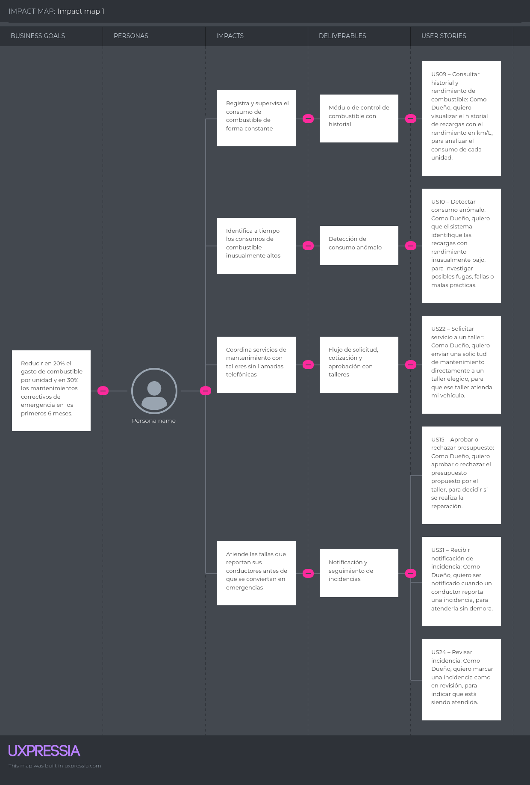
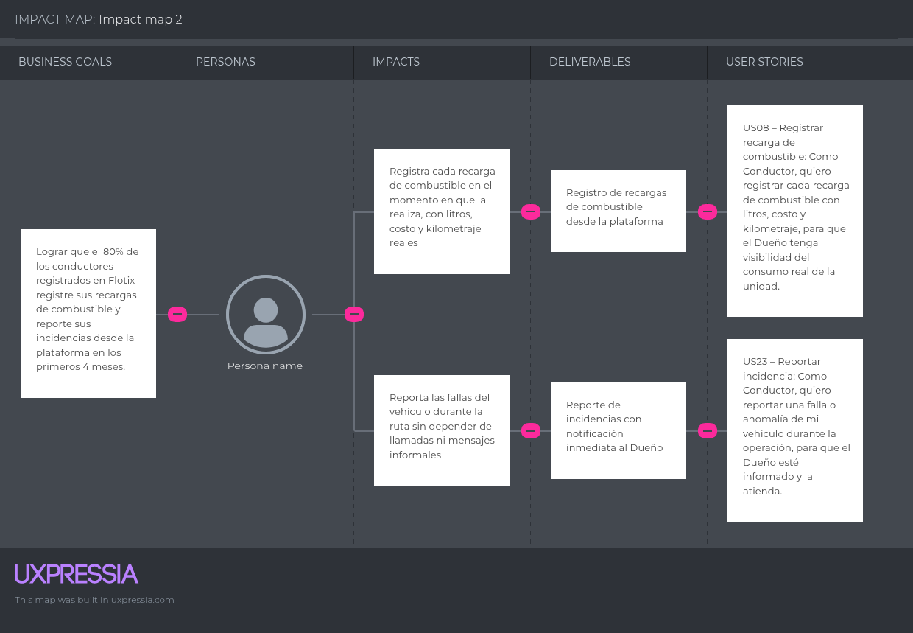
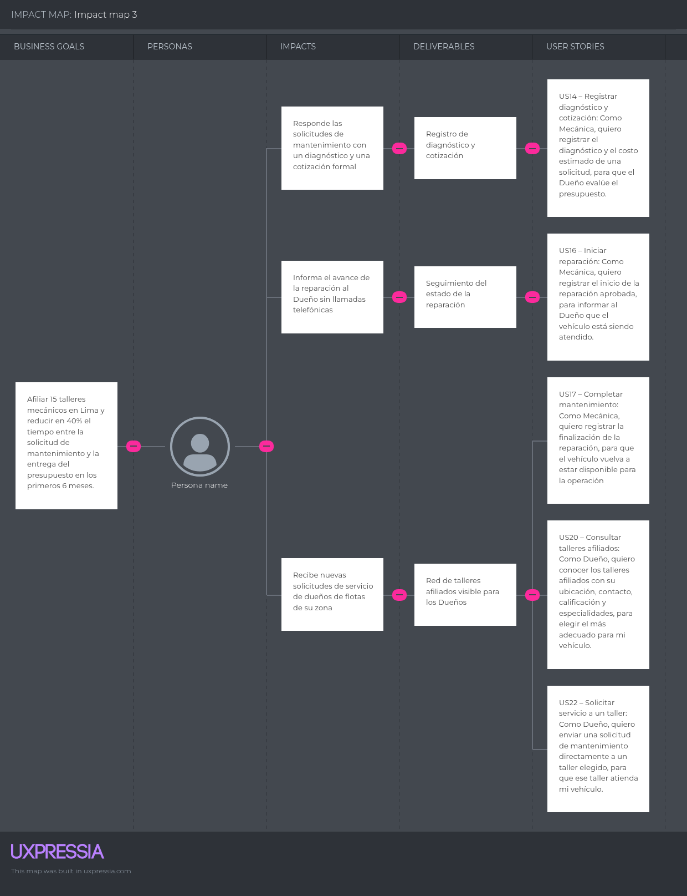

## 3.2. Impact Mapping

El Impact Mapping es una herramienta de planificación estratégica que nos permite conectar los objetivos de negocio de Flotix con los comportamientos de cada segmento objetivo.

### Impact Map – Segmento 1: Dueño

> **Figura 16.** Impact Map del segmento Dueño.
>
> 

### Impact Map – Segmento 2: Conductor

> **Figura 17.** Impact Map del segmento Conductor.
>
> 

### Impact Map – Segmento 3: Mecánica

> **Figura 18.** Impact Map del segmento Mecánica.
>
> 