## 5.2. Landing Page, Services & Applications Implementation

En esta sección se describe el proceso de implementación del producto Flotix, incluyendo el desarrollo, pruebas, documentación y despliegue del Landing Page.

Para este avance (AV1), se implementó la primera versión del Landing Page, orientada a presentar la propuesta de valor de Flotix a los tres segmentos objetivo (Dueño, Conductor y Mecánica). El desarrollo se realizó utilizando tecnologías web estándar (HTML5, CSS3, JavaScript) y GitHub como herramienta de control de versiones.

### 5.2.1. Sprint 1

En esta sección se presenta el avance del Sprint 1 en términos de desarrollo del producto y trabajo colaborativo del equipo. Durante este sprint se realizó la implementación de la primera versión del Landing Page de Flotix, enfocada en presentar la propuesta de valor de la plataforma a los visitantes y guiarlos hacia el registro según su rol (Dueño, Conductor o Mecánica).

#### 5.2.1.1. Sprint Planning 1

| Campo | Detalle |
|---|---|
| **Sprint #** | Sprint 1 |
| **Sprint Planning Background** | |
| Date | 14-09-2026 |
| Time | 17:30 |
| Location | Reunión virtual (Google Meet / Microsoft Teams) |
| Prepared By / Attendees | Jaime Forcelledo, Gonzalo Alexander · Ramirez Rodriguez, Mauricio Joao |
| Sprint 1 – 1 Review Summary | Al tratarse del primer sprint del proyecto, no se cuenta con una iteración previa. Se tomó como base el Product Backlog priorizado y los principios de diseño definidos en el Capítulo IV (Style Guidelines e Information Architecture). |
| Sprint 1 – 1 Retrospective Summary | No aplica para este sprint. El equipo acordó enfocarse en una correcta distribución de tareas por sección del Landing Page y en mantener comunicación constante desde el inicio del desarrollo. |
| **Sprint Goal & User Stories** | |
| Sprint 1 Goal | Our focus is on developing a functional and responsive landing page that presents the value proposition of Flotix to vehicle owners, drivers, and mechanic workshops. We believe it delivers a clear understanding of the product and a direct path to registration for each segment. This will be confirmed when visitors can view the landing page, navigate between its sections, view it correctly across devices, and reach the registration flow from any call-to-action. |
| User Stories incluidas en el Sprint | US29: Visualizar Landing Page (3) · US30: Navegar entre secciones del Landing Page (2) · US31: Visualización responsive del Landing Page (5) · US32: Redirigir desde Landing Page a registro (3) |
| Sprint 1 Velocity | 13 Story Points |
| Sum of Story Points | 13 Story Points |

#### 5.2.1.2. Aspect Leaders and Collaborators

En esta sección se define la matriz de liderazgo y colaboración (LACX) del Sprint 1, la cual permite identificar las responsabilidades de cada integrante del equipo en los distintos aspectos del desarrollo del Landing Page.

*L = Leader · C = Collaborator*

| Team Member (Last Name, First Name) | GitHub Username | Estructura del Landing Page | Navegación entre secciones | Diseño Responsive |
|---|---|:---:|:---:|:---:|
| Jaime Forcelledo, Gonzalo Alexander | gonzalojaimeforcelledo | L | C | C |
| Ramirez Rodriguez, Mauricio | MauRicio1321rr | C | C | L |
| Olivares Lao, Gustavo | GeGuMaGu25 | C | C | C |
| Lechuga Aguilar, Joaquin | joaquin-aguilar | C | L | C |

#### 5.2.1.3. Sprint Backlog 1

El Sprint 1 tuvo como objetivo principal la implementación del Landing Page de Flotix, permitiendo presentar la propuesta de valor del sistema mediante una interfaz clara, estructurada y accesible para los tres segmentos objetivo. Para la gestión del Sprint Backlog se utiliza Trello, organizando los User Stories y sus respectivos Work-Items/Tasks en columnas según su estado de avance (To-do / In-Process / To-Review / Done).

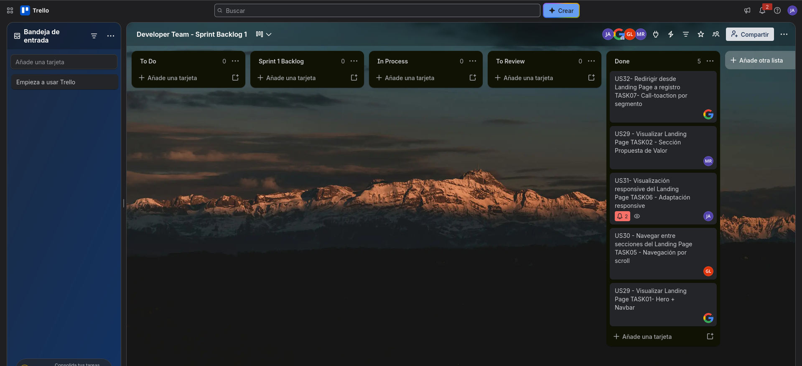

**URL del Board:** https://trello.com/invite/b/6aa4d8d2372dbba6abaa9614/ATTI169be87b0916b465e22e953638c3ad30AFD2832F/developer-team-sprint-backlog-1

| User Story | Work-Item / Task | Descripción | Estimation (Hours) | Assigned To | Status |
|---|---|---|:---:|---|:---:|
| US29 - Visualizar Landing Page | TASK01 - Hero + Navbar | Implementación de la sección principal (Hero) y la barra de navegación del Landing Page | 4 | Gonzalo Jaime Forcelledo | Done |
| US29 - Visualizar Landing Page | TASK02 - Sección Propuesta de Valor | Desarrollo de la sección que presenta la propuesta de valor y los tres segmentos objetivo (Dueño, Conductor, Mecánica) | 4 | Mauricio Ramirez Rodriguez | Done |
| US30 - Navegar entre secciones del Landing Page | TASK05 - Navegación por scroll | Implementación del desplazamiento suave (smooth scroll) entre secciones desde el menú de navegación | 3 | Gustavo Olivares Lao | Done |
| US31 - Visualización responsive del Landing Page | TASK06 - Adaptación responsive | Adaptación de todas las secciones del Landing Page a dispositivos móviles y tablets mediante media queries | 5 | Joaquin Lechuga Aguilar | Done |
| US32 - Redirigir desde Landing Page a registro | TASK07 - Call-to-action por segmento | Implementación de los botones "Comenzar ahora" en cada sección, redirigiendo al registro con el rol correspondiente preseleccionado | 3 | Gonzalo Jaime Forcelledo | Done |

#### 5.2.1.4. Development Evidence for Sprint Review

En este Sprint se logró la implementación de la estructura principal del Landing Page de Flotix en HTML y CSS, junto con la navegación entre secciones y los primeros avances en el diseño responsive. El desarrollo se organizó mediante ramas de tipo feature en GitHub, permitiendo trabajar en paralelo en las distintas secciones del sitio. A continuación, se presentan los commits más relevantes asociados al desarrollo del Sprint 1.

| Repository | Branch | Commit Message | Commit Message Body | Committed on (Date) |
|---|---|---|---|:---:|
| flotix-website | feature/html | `feat(html): add file index.html` | Se implementa la estructura o esqueleto HTML | 16/09/2026 |
| flotix-website | feature/css | `feat(css): add css` | Se implementa los estilos a la estructura | 16/09/2026 |
| flotix-website | feature/images | `feat(images): add photos jpg png of images` | Se implementa las imágenes a la estructura con los estilos | 16/09/2026 |
| flotix-website | feature/javascript | `feat(javascript): add javascript main.js for dynamic` | Se implementa el idioma por i18n y hace la landing page dinámica | 16/09/2026 |

#### 5.2.1.5. Execution Evidence for Sprint Review

En el Sprint 1 se logró implementar el Landing Page de Flotix, permitiendo presentar la propuesta de valor del sistema a través de una interfaz clara, organizada y accesible para los tres segmentos objetivo. Se desarrollaron las principales secciones del Landing Page: Hero, propuesta de valor por segmento, dispositivo IoT, talleres afiliados y footer, además de la navegación entre secciones mediante scroll y los primeros avances en la adaptación responsive.

**Video de Demostración de Navegación (Landing Page):** https://n9.cl/xzcd89

**Screenshots del Landing Page**

> 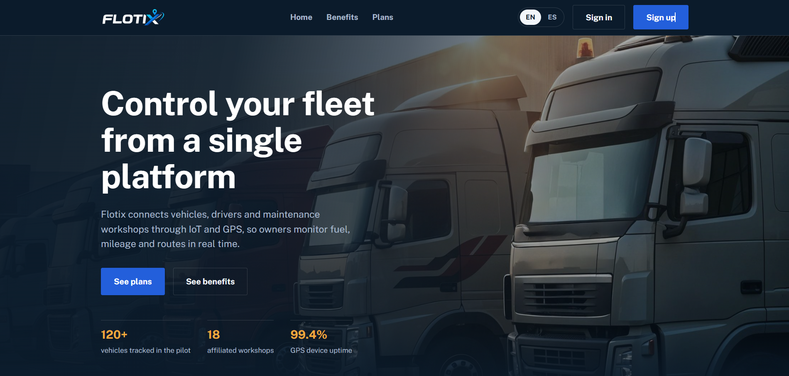

> *Vista general (Hero + Navbar)*

> 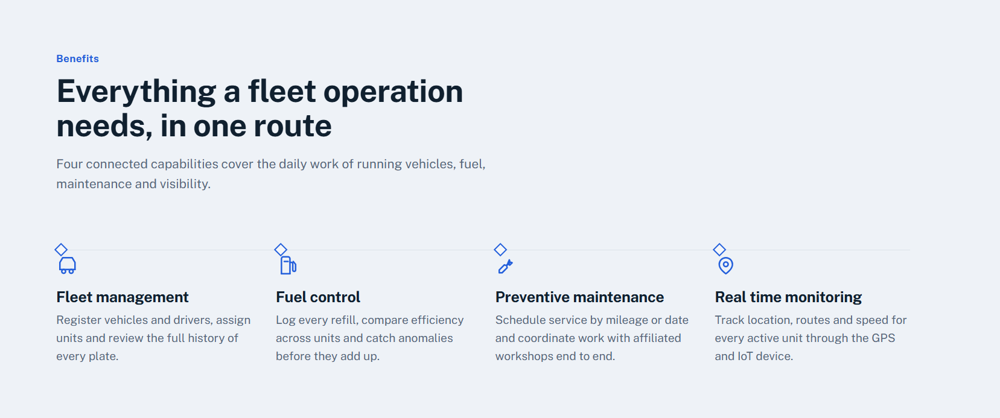

> *Sección Beneficios*

> 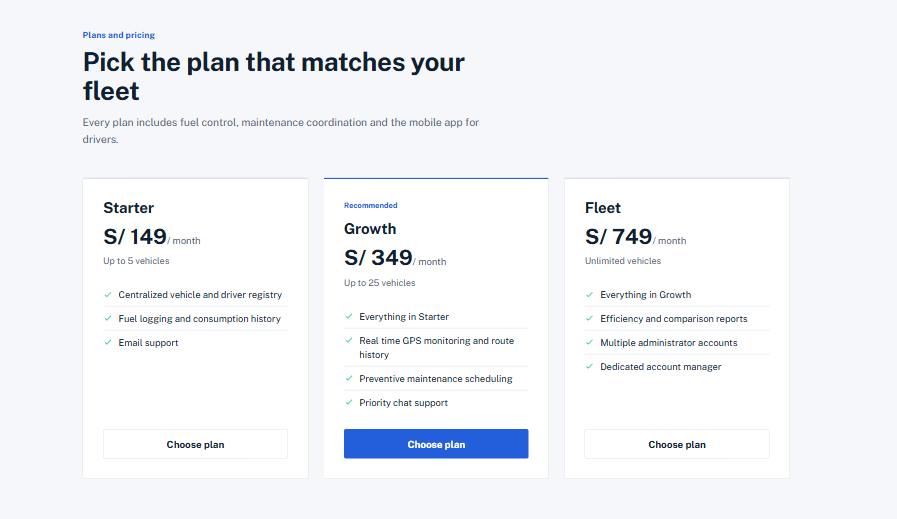

> *Sección Planes*

> 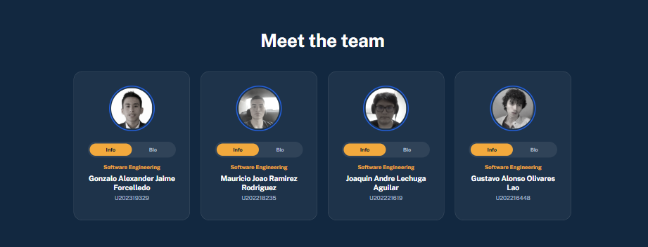

> *Sección About the Team*

> 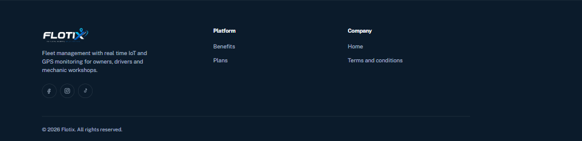

> *Sección Footer*

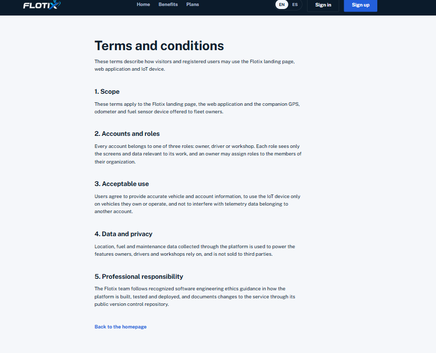

> *Sección Términos y condiciones*

#### 5.2.1.6. Services Documentation Evidence for Sprint Review

En el presente Sprint no se implementaron Web Services ni endpoints funcionales, debido a que el alcance de esta primera entrega estuvo enfocado en el desarrollo del Landing Page como carta de presentación del producto.

#### 5.2.1.7. Software Deployment Evidence for Sprint Review

El despliegue del Landing Page de Flotix se realizó utilizando GitHub Pages, aprovechando su capacidad de publicar sitios web estáticos directamente desde un repositorio, sin necesidad de infraestructura adicional.

**Infraestructura de Despliegue**

- Repositorio de código fuente: GitHub (`flotix-landing`)

- Plataforma de despliegue: GitHub Pages

- Tipo de aplicación: sitio estático (HTML, CSS, JavaScript)

- Acceso: URL pública generada por GitHub

**Proceso de Despliegue**

1. **Creación del repositorio:** Se creó el repositorio `flotix-landing` conteniendo todos los archivos del Landing Page, asegurando que `index.html` se encuentre en la raíz.

2. **Subida del código:**

- Se realizó el push del proyecto a la rama principal (`main`) del repositorio.

- Se verificó que todos los recursos estén correctamente enlazados (rutas relativas).

3. **Configuración de GitHub Pages:**

- En la sección Settings del repositorio, se habilitó GitHub Pages.

- Se seleccionó la rama `main` como fuente de despliegue.

- Se definió la carpeta raíz (`/root`) como directorio de publicación.

4. **Publicación automática:**

- GitHub Pages procesó automáticamente el contenido del repositorio.

- En pocos minutos, generó una URL pública donde la Landing Page quedó disponible.

5. **Actualizaciones:**

- Cada vez que se realiza un nuevo push a la rama `main`, GitHub Pages actualiza automáticamente la página.

- Esto permite mantener la Landing Page sincronizada con los cambios del repositorio sin intervención manual adicional.

**Resultado**

La Landing Page de Flotix fue desplegada exitosamente mediante GitHub Pages, permitiendo su acceso público a través de una URL estable. Esto facilita la presentación del producto a usuarios potenciales y valida la propuesta de valor del sistema de manera rápida y efectiva.

**URL:** https://upc-pre-202620-1asi0730-8150-devsteam.github.io/flotix-website

#### 5.2.1.8. Team Collaboration Insights during Sprint

Durante el Sprint 1, el equipo Developers Team trabajó de manera colaborativa en la implementación del Landing Page de Flotix, organizando las tareas por sección de la interfaz para permitir el desarrollo en paralelo. Cada integrante asumió la responsabilidad de una parte específica del Landing Page (Hero, propuesta de valor, dispositivo IoT, talleres afiliados y footer), lo que permitió avanzar de forma eficiente y reducir conflictos en el código. Se utilizó GitHub como herramienta principal de control de versiones, gestionando el trabajo mediante ramas feature y commits individuales revisados antes de integrarse a develop.

La integración del trabajo se realizó de manera progresiva, consolidando las distintas secciones en una única versión funcional del Landing Page.

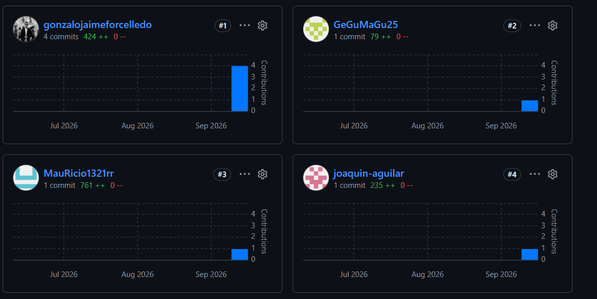

### 5.2.2. Sprint 2

En esta sección se registra y explica el avance en términos de producto y trabajo colaborativo para el Sprint 2. A diferencia del Sprint 1, enfocado exclusivamente en el Landing Page, este sprint entrega la primera versión completa de la Web Application de Flotix: los 9 Bounded Contexts definidos en el Capítulo IV (Identity, Fleet, Fuel Control, Maintenance, Incidents, Tracking, Alerts, IoT Commerce y Analytics), navegables de extremo a extremo para los tres roles (Dueño, Conductor, Mecánica), construida sobre una capa de persistencia local que replica el contrato de la futura API Application.

#### 5.2.2.1. Sprint Planning 2

| Campo | Detalle |
|---|---|
| **Sprint #** | Sprint 2 |
| **Sprint Planning Background** | |
| Date | 2026-09-21 |
| Time | 17:30 |
| Location | Reunión virtual (Google Meet) |
| Prepared By | Jaime Forcelledo, Gonzalo Alexander |
| Attendees (to planning meeting) | Jaime Forcelledo, Gonzalo Alexander · Ramirez Rodriguez, Mauricio Joao · Lechuga Aguilar, Joaquin Andre · Olivares Lao, Gustavo Alonso |
| Sprint 1 Review Summary | Durante el Sprint 1 se implementó y desplegó correctamente el Landing Page responsive de Flotix en GitHub Pages, cumpliendo las 4 User Stories planificadas (US29–US32). El equipo validó la navegación entre secciones y la adaptación a dispositivos móviles, y consolidó GitFlow y Conventional Commits como estándar de trabajo. |
| Sprint 1 Retrospective Summary | El equipo identificó como fortaleza la división del trabajo por sección del Landing Page. Como oportunidad de mejora, se acordó no bloquear el desarrollo del frontend a la espera del API Application: se definiría una capa de persistencia local que replique el contrato del backend real, permitiendo avanzar con los 9 Bounded Contexts en paralelo y swapear la implementación por un cliente HTTP una vez el API esté disponible. |
| **Sprint Goal & User Stories** | |
| Sprint 2 Goal | Our focus is on delivering the first complete version of the Flotix Web Application covering authentication, fleet and driver management, fuel control, preventive maintenance with workshops, incident reporting, real-time IoT tracking, alerts, the IoT device store, and analytics for the three user roles (Dueño, Conductor, Mecánica), built against a local persistence layer that mirrors the target API Application's contract. We believe it delivers a complete, navigable product experience the team can validate end-to-end before the real backend is integrated. This will be confirmed when each of the three demo accounts (Owner, Driver, Mechanic) can log in and operate every module relevant to their role, with the business rules from Chapters I and III enforced in the UI. |
| User Stories / Epics incluidos | EP05 Identity, Profiles & Security (login, registro, sesión por rol) EP01 Vehicle & Fleet Management (vehículos, conductores) EP02 Fuel Control (registro e historial de combustible) EP03 Maintenance Management (solicitudes, cotizaciones, talleres) · Incident Management (reporte de incidencias) EP04 Real-Time Monitoring (tracking IoT) · Alerts & Notifications EP06 IoT Commerce (tienda de dispositivos) · Reporting & Analytics |
| Sprint 2 Velocity | 33 Story Points |
| Sum of Story Points | 33 Story Points |

#### 5.2.2.2. Aspect Leaders and Collaborators

En esta sección se define la matriz de liderazgo y colaboración (LACX) del Sprint 2. Dado que el alcance cubre los 9 Bounded Contexts del frontend, los aspectos se organizan por Bounded Context en lugar de por sección visual.

| Team Member | GitHub Username | Identity + Platform Shell | Fleet + Analytics | Fuel + Maintenance | Tracking + Alerts + Commerce |
|---|---|:---:|:---:|:---:|:---:|
| Jaime Forcelledo, Gonzalo Alexander | gonzalojaimeforcelledo | L | C | C | C |
| Ramirez Rodriguez, Mauricio | MauRicio1321rr | C | L | C | C |
| Lechuga Aguilar, Joaquin | joaquin-aguilar | C | C | L | C |
| Olivares Lao, Gustavo | GeGuMaGu25 | C | C | C | L |

#### 5.2.2.3. Sprint Backlog 2

El Sprint 2 tuvo como objetivo principal construir la Web Application completa de Flotix siguiendo Domain-Driven Design, con una carpeta independiente por Bounded Context (domain / application / infrastructure / presentation), autenticación por rol y una capa de persistencia local que mantiene el mismo contrato que tendrá el futuro cliente HTTP contra el API Application.

**URL del Board:** https://trello.com/invite/b/6ac1585ab6a4d7605848bae2/ATTI1c6deef09403b58e03ceda301a4bbe43F73C7F73/developer-team-sprint-backlog-2

> 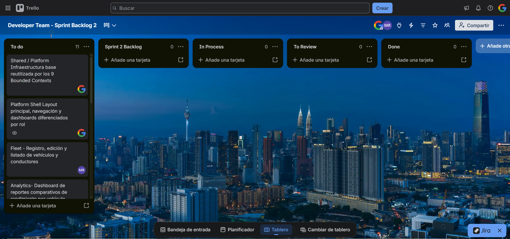
> *Tablero Trello del Sprint 2: tareas en To do*

> 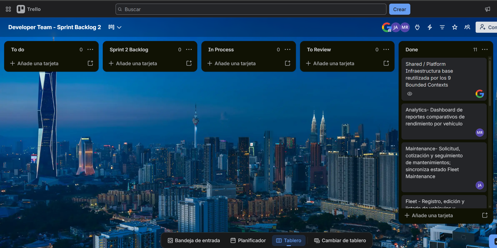
> *Tablero Trello del Sprint 2: tareas en Done*

| Bounded Context | Work-Item / Task | Descripción | Hrs | Assigned To | Status |
|---|---|---|:---:|---|:---:|
| Shared / Platform | Kernel compartido: `BaseEntity`, `LocalStorageRepository`, `session.js` | Infraestructura base reutilizada por los 9 Bounded Contexts | 5 | Gonzalo | Done |
| Platform Shell | `main-layout.component.vue`, dashboards por rol, `settings.view.vue`, `not-found.view.vue` | Layout principal, navegación y dashboards diferenciados por rol | 8 | Gonzalo | Done |
| Fleet | `fleet-list.view.vue`, `vehicle-form.view.vue`, `drivers-list.view.vue` | Registro, edición y listado de vehículos y conductores | 6 | Mauricio | Done |
| Analytics | `analytics-dashboard.view.vue`, `report.entity.js` | Dashboard de reportes comparativos de rendimiento por vehículo | 4 | Mauricio | Done |
| Fuel Control | `fuel-list.view.vue`, `fuel-form.view.vue`, `fuel-record.entity.js` | Registro e historial de combustible, detección de consumo anómalo (&lt;70% del promedio) | 5 | Joaquin | Done |
| Maintenance | `maintenance-*-form.view.vue`, `workshops-list.view.vue`, `workshop-request-form.view.vue` | Solicitud, cotización y seguimiento de mantenimientos; sincroniza estado Fleet ↔ Maintenance | 9 | Joaquin | Done |
| Incidents | `incidents-list.view.vue`, `incident-form.view.vue` | Reporte de incidencias; dispara notificación automática al Dueño | 4 | Joaquin | Done |
| Tracking | `tracking-dashboard.view.vue`, `iot-device.entity.js`, `telemetry-data.entity.js` | Monitoreo en tiempo real simulado, evaluación de límite de velocidad (90 km/h) | 6 | Gustavo | Done |
| Alerts | `alerts-list.view.vue`, `alert.entity.js`, `notification.entity.js` | Listado centralizado de alertas y notificaciones (Tracking + Incidents) | 3 | Gustavo | Done |
| IoT Commerce | `commerce-store.view.vue`, `iot-order.entity.js` | Tienda del dispositivo IoT; confirma pago simulado y cambia pedido a "En preparación" | 4 | Gustavo | Done |
| Platform Shell | `plugins/i18n.js`, `content.js`, `theme/flotix-preset.js` | Internacionalización (EN por defecto / ES-419) y theme preset de PrimeVue | 4 | Gonzalo | Done |

#### 5.2.2.4. Development Evidence for Sprint Review

En este Sprint se implementó la estructura completa de la Web Application en Vue 3 + Vite, con Pinia para el estado, PrimeVue/PrimeFlex para los componentes de UI y vue-i18n para la internacionalización. El desarrollo se organizó mediante una rama `feature/<bounded-context>` por cada uno de los 9 Bounded Contexts, integradas a `develop` a través de Pull Requests.

| Repository | Branch | Committed By | Date |
|---|---|---|:---:|
| flotix-webapp | develop | gonzalojaimeforcelledo | 2026-10-03 |
| flotix-webapp | feature/shared-kernel | gonzalojaimeforcelledo | 2026-10-03 |
| flotix-webapp | develop | gonzalojaimeforcelledo | 2026-10-03 |
| flotix-webapp | feature/identity | gonzalojaimeforcelledo | 2026-10-03 |
| flotix-webapp | feature/identity | gonzalojaimeforcelledo | 2026-10-03 |
| flotix-webapp | develop | gonzalojaimeforcelledo | 2026-10-03 |
| flotix-webapp | feature/platform-shell | gonzalojaimeforcelledo | 2026-10-03 |
| flotix-webapp | feature/platform-shell | gonzalojaimeforcelledo | 2026-10-03 |
| flotix-webapp | feature/platform-shell | gonzalojaimeforcelledo | 2026-10-03 |
| flotix-webapp | develop | MauRicio1321rr | 2026-10-03 |
| flotix-webapp | feature/fleet | MauRicio1321rr | 2026-10-03 |
| flotix-webapp | feature/fleet | MauRicio1321rr | 2026-10-03 |
| flotix-webapp | develop | MauRicio1321rr | 2026-10-03 |
| flotix-webapp | feature/analytics | MauRicio1321rr | 2026-10-03 |
| flotix-webapp | develop | joaquin-aguilar | 2026-10-03 |
| flotix-webapp | feature/fuel-control | joaquin-aguilar | 2026-10-03 |
| flotix-webapp | feature/fuel-control | joaquin-aguilar | 2026-10-03 |
| flotix-webapp | develop | joaquin-aguilar | 2026-10-03 |
| flotix-webapp | feature/maintenance | joaquin-aguilar | 2026-10-03 |
| flotix-webapp | feature/maintenance | joaquin-aguilar | 2026-10-03 |
| flotix-webapp | feature/incidents | joaquin-aguilar | 2026-10-03 |
| flotix-webapp | develop | GeGuMaGu25 | 2026-10-03 |
| flotix-webapp | feature/tracking | GeGuMaGu25 | 2026-10-03 |
| flotix-webapp | feature/tracking | GeGuMaGu25 | 2026-10-03 |
| flotix-webapp | develop | GeGuMaGu25 | 2026-10-03 |
| flotix-webapp | feature/alerts | GeGuMaGu25 | 2026-10-03 |
| flotix-webapp | feature/iot-commerce | GeGuMaGu25 | 2026-10-03 |

#### 5.2.2.5. Execution Evidence for Sprint Review

En el Sprint 2 se logró implementar y navegar de extremo a extremo la primera versión de la Web Application de Flotix para los tres roles. Las reglas de negocio centrales ya operan sobre la UI: licencia obligatoria para Conductor, sincronización de estado Fleet ↔ Maintenance durante una reparación, detección de consumo anómalo de combustible, disparo de alertas desde Incidents y Tracking, confirmación de pago en IoT Commerce, y exclusión de vehículos con menos de 2 registros históricos en Analytics.

**Video de Demostración de Navegación (Web Application):** https://acortar.link/h01YBa

**Screenshots de la Web Application**

**Dueño:**

> 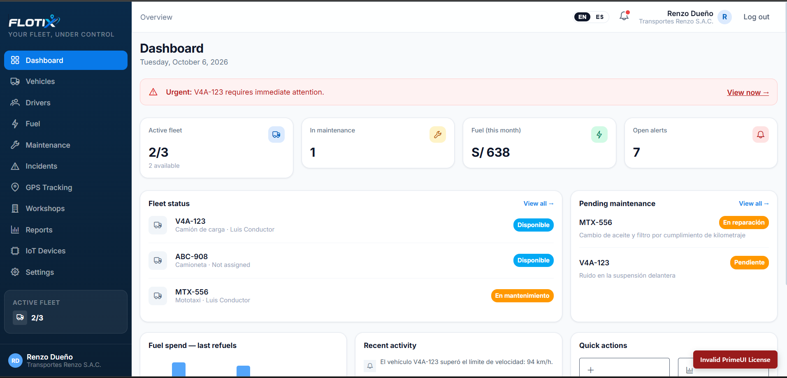
> *Dashboard del Dueño*

**Conductor:**

> 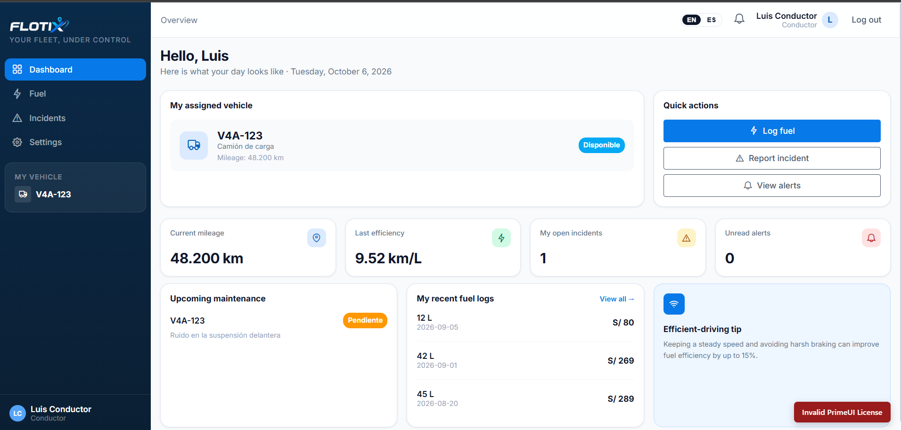
> *Dashboard del Conductor*

**Mecánica:**

> 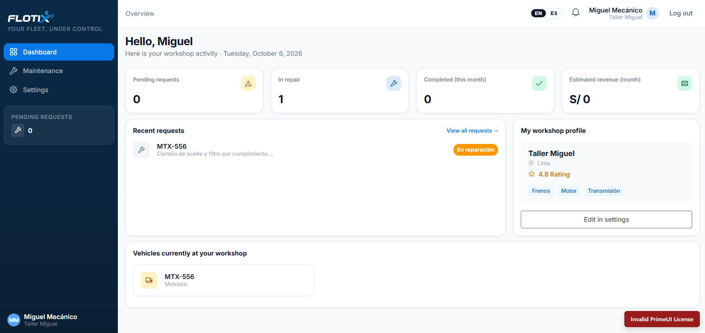
> *Dashboard de la Mecánica*

#### 5.2.2.6. Services Documentation Evidence for Sprint Review

En este Sprint no se implementaron Web Services reales: el API Application (C# / .NET Core Minimal APIs, descrita en el Container Diagram del Capítulo IV) se desarrollará en un sprint posterior. Para no bloquear el avance del frontend, cada Bounded Context persiste sus datos mediante LocalStorageRepository, una clase de infraestructura genérica que replica exactamente el contrato que expondrá el repositorio real contra la API (getAll, getById, findBy, add, update, remove).

| Método del contrato | Equivalente futuro en la API |
|---|---|
| `getAll()` | `GET /api/<recurso>` |
| `getById(id)` | `GET /api/<recurso>/{id}` |
| `add(record)` | `POST /api/<recurso>` |
| `update(id, patch)` | `PUT /api/<recurso>/{id}` |
| `remove(id)` | `DELETE /api/<recurso>/{id}` |

Esto permite que, cuando el API Application esté disponible, solo se reemplace la capa de infraestructura de cada Bounded Context (el repositorio) por un cliente HTTP sin tocar las capas de aplicación ni de presentación.

**Repositorio del frontend:** https://github.com/upc-pre-202620-1asi0730-8150-DevsTeam/flotix-webapp

#### 5.2.2.7. Software Deployment Evidence for Sprint Review

Al ser, por ahora, una SPA sin backend real, el despliegue del Sprint 2 se limita a publicar el build estático de la Web Application.

**Infraestructura utilizada**

- GitHub como repositorio principal (`flotix-webapp`).
- GitHub Pages para el despliegue del Landing Page.
- Vue.js + Vite para la construcción de la Web Application.

**Proceso de Deployment**

1. **Build de producción:** se generó el build de la Web Application con Vite (`npm run build`), produciendo la carpeta `dist/`.
2. **Publicación:** se desplegó el contenido de `dist/` en la plataforma de hosting estático elegida.
3. **Verificación:** se probó el flujo (Owner, Driver, Mechanic), confirmando que cada rol ve únicamente su dashboard y navegación correspondiente.
4. **Persistencia:** se documentó que los datos se almacenan en `localStorage` del navegador (con datos semilla), por lo que cada visitante parte de un estado demo independiente hasta la integración con el API Application real.

**Resultado**

Se logró desplegar la primera versión completa de la Web Application de Flotix, cubriendo los 9 Bounded Contexts definidos en el Capítulo IV, navegable de extremo a extremo para los tres roles sobre datos de demostración.

**URL Web Application:** *https://flotix-app-web.netlify.app/dashboard*

#### 5.2.2.8. Team Collaboration Insights during Sprint

Durante el Sprint 2, el equipo Developers Team distribuyó el trabajo por Bounded Context siguiendo estrictamente la arquitectura DDD definida en el Capítulo IV: Gonzalo Jaime Forcelledo lideró el kernel compartido, Identity y el shell de la plataforma (layout, dashboards por rol, i18n y theme); Mauricio Ramirez Rodriguez lideró Fleet y Analytics; Joaquin Lechuga Aguilar lideró Fuel Control, Maintenance e Incidents; y Gustavo Olivares Lao lideró Tracking, Alerts e IoT Commerce.

Siguiendo la retrospectiva del Sprint 1, el equipo decidió no esperar al API Application para avanzar: se acordó un contrato de repositorio único que los cuatro integrantes reutilizaron en sus respectivos Bounded Contexts, lo que permitió que los 9 módulos se desarrollaran en paralelo sin bloqueos entre sí. El trabajo se organizó mediante GitHub con GitFlow, una rama `feature/<bounded-context>` por módulo, y Pull Requests revisados por al menos un integrante antes de cada merge a `develop`.

> 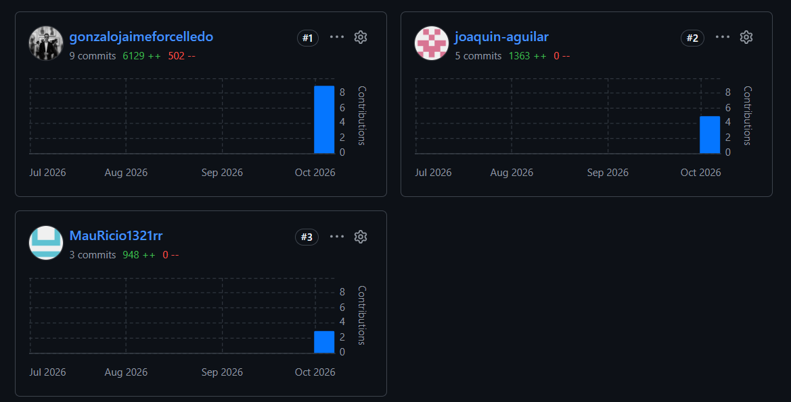

### 5.2.3. Sprint 3

En esta sección se registra y explica el avance en términos de producto y trabajo colaborativo del Sprint 3. A diferencia del Sprint 1, enfocado en el Landing Page, y del Sprint 2, que entregó la Web Application sobre una capa de persistencia local, este sprint entrega la primera versión de los Web Services de Flotix: el API Application en C# con .NET Core Minimal APIs y PostgreSQL, documentado con OpenAPI (Swagger) y desplegado en la nube. El sprint también integra la Web Application con el API en los módulos respaldados por las Technical Stories TS01 a TS04, y completa las historias pendientes del Landing Page (EP09): videos, cambio de idioma y accesibilidad.

#### 5.2.3.1. Sprint Planning 3

| Campo | Detalle |
|---|---|
| **Sprint #** | Sprint 3 |
| **Sprint Planning Background** | |
| Date | 2026-10-28|
| Time | 18:00 |
| Location | Reunión virtual (Google Meet) |
| Prepared By | Jaime Forcelledo, Gonzalo Alexander |
| Attendees (to planning meeting) | Jaime Forcelledo, Gonzalo Alexander · Ramirez Rodriguez, Mauricio Joao · Lechuga Aguilar, Joaquin Andre · Olivares Lao, Gustavo Alonso |
| Sprint 2 Review Summary | Durante el Sprint 2 se implementó la primera versión de la Web Application de Flotix en Vue 3 con una carpeta independiente por Bounded Context, navegable de extremo a extremo para los tres roles (Dueño, Conductor y Mecánica) y desplegada en Netlify. Los datos se persistieron mediante `LocalStorageRepository`, que replica el contrato del futuro API (`getAll`, `getById`, `findBy`, `add`, `update`, `remove`). No se implementaron Web Services reales. |
| Sprint 2 Retrospective Summary | El equipo identificó como fortaleza el contrato de repositorio único reutilizado por los cuatro integrantes, que permitió desarrollar los módulos en paralelo sin bloqueos. Como oportunidad de mejora, se acordó implementar el API Application para reemplazar la capa local por un cliente HTTP sin modificar las capas de aplicación ni de presentación, documentar los endpoints con OpenAPI desde el inicio y completar las historias pendientes del Landing Page requeridas para la entrega. |
| **Sprint Goal & User Stories** | |
| Sprint 3 Goal | Our focus is on delivering the first deployed version of the Flotix RESTful API, covering vehicle management, IoT telemetry ingestion, the maintenance request lifecycle between owners and workshops, and fuel and maintenance reports, together with the integration of the Web Application with these services and the completion of the Landing Page (videos, language switch and accessibility). We believe it delivers a documented and testable backend that replaces local persistence in the integrated modules, and a Landing Page ready for the product and team videos. This will be confirmed when every endpoint in scope is documented in Swagger and reachable from the deployed environment, the Fleet, Tracking, Maintenance and Analytics modules consume the API, and the Landing Page shows both videos, switches between English and Spanish, and can be used with keyboard and screen reader. |
| User Stories incluidas en el Sprint | **Web Services:** TS01: Implementar registro y consulta de vehículos vía API (3) · TS02: Implementar ingesta de datos IoT en tiempo real (8) · TS03: Implementar flujo de solicitud de mantenimiento entre Dueño y Mecánica (5) · TS04: Implementar generación de reportes (5) **Landing Page (EP09):** US49: Ver video About the Product (2) · US51: Ver video About the Team (2) · US53: Cambiar idioma (3) · US54: Acceder al contenido de forma accesible (2) |
| Fuera del alcance del Sprint | Los módulos Fuel Control, Incidents, Alerts e IoT Commerce, y la autenticación por rol mediante JWT (Auth Service), continúan sobre la capa de persistencia local, ya que el capítulo 3 no define Technical Stories para ellos. **[CONFIRMAR]** |
| Sprint 3 Velocity | 30 Story Points |
| Sum of Story Points | 30 Story Points |

#### 5.2.3.2. Aspect Leaders and Collaborators

En esta sección se define la matriz de liderazgo y colaboración (LACX) del Sprint 3. Los aspectos se organizan por área de responsabilidad y respetan la distribución de bounded contexts del Sprint 2: Gonzalo conserva la plataforma, Mauricio Fleet y Analytics, Joaquin Maintenance, y Gustavo Tracking.

*L = Leader · C = Collaborator*

| Team Member (Last Name, First Name) | GitHub Username | Platform, OpenAPI & Deployment | Fleet & Reports | Maintenance & Landing Page | IoT Telemetry |
|---|---|:---:|:---:|:---:|:---:|
| Jaime Forcelledo, Gonzalo Alexander | gonzalojaimeforcelledo | L | C | C | C |
| Ramirez Rodriguez, Mauricio | MauRicio1321rr | C | L | C | C |
| Lechuga Aguilar, Joaquin | joaquin-aguilar | C | C | L | C |
| Olivares Lao, Gustavo | GeGuMaGu25 | C | C | C | L |

#### 5.2.3.3. Sprint Backlog 3

El Sprint 3 tuvo como objetivo principal implementar, documentar y desplegar la primera versión del API Application de Flotix, integrarla con los módulos de la Web Application y distribuir el trabajo por bounded context entre los cuatro integrantes. La gestión del Sprint Backlog se realiza en Trello, con las columnas To-do / In-Process / To-Review / Done.

**URL del Board: https://trello.com/invite/b/6adf70a966d4291bccf690d2/ATTIc667f3a211184f0a0f5333d95c73e66c8A418E19/developer-team-sprint-backlog-3

> 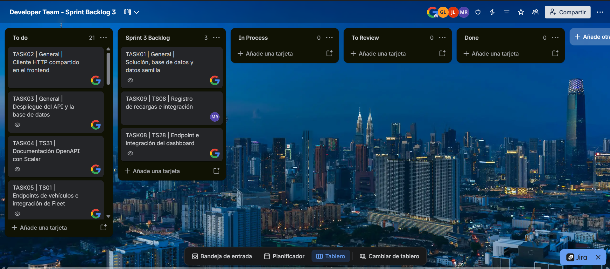
> *Tablero Trello del Sprint 3: tareas en To do*

> 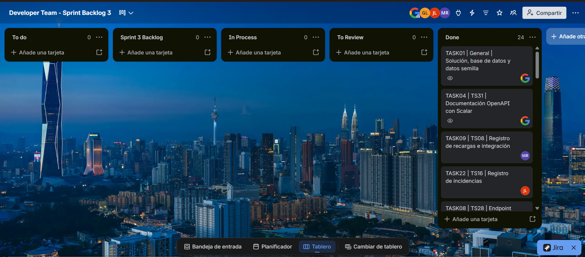
> *Tablero Trello del Sprint 3: tareas en Done*

**Sprint #:** Sprint 3

| Story Id | Story Title | Task Id | Task Title | Task Description | Assigned To | Estimation (Hours) |     Status      |
|---|---|:---:|---|---|---|:---:|:---------------:|
| General | Constraint técnico del API | TASK01 | Solución, base de datos y datos semilla | Creación de la solución .NET con Minimal APIs organizada por bounded context, esquemas lógicos en PostgreSQL, migraciones con Entity Framework Core y datos semilla de `users`, `vehicles`, `fuel_records`, `maintenance_requests`, `incidents` e `iot_devices` | Gonzalo Jaime Forcelledo | 8 |        Done        |
| General | Constraint técnico del API | TASK02 | Cliente HTTP compartido en el frontend | Implementación del cliente HTTP base en `flotix-webapp` con el mismo contrato de `LocalStorageRepository`, para reemplazar la capa local por módulo | Gonzalo Jaime Forcelledo | 5 | Done |
| General | Constraint técnico del API | TASK03 | Despliegue del API y la base de datos | Configuración del servicio en la nube, variables de entorno, cadena de conexión, CORS y publicación desde la rama principal | Gonzalo Jaime Forcelledo | 6 | Done |
| TS31 | Documentar el RESTful API con OpenAPI | TASK04 | Documentación OpenAPI | Generación de la especificación OpenAPI y configuración de Scalar como interfaz de consulta, con inglés como idioma por defecto, agrupación por bounded context y ejemplos de request y response | Gonzalo Jaime Forcelledo | 4 | Done |
| TS01 | Implementar registro y consulta de vehículos vía API | TASK05 | Endpoints de vehículos e integración de Fleet | Agregado `Vehicle`, repositorio, endpoints `POST` y `GET` de `/vehicles` con respuestas 201 y 400, e integración de las vistas de registro y listado | Gonzalo Jaime Forcelledo | 8 | Done |
| TS05 | Implementar actualización y eliminación de vehículos vía API | TASK06 | Actualización y eliminación de vehículos | Endpoints `PUT` y `DELETE` de `/vehicles/{id}` con respuestas 200, 204 y 404, e integración de la edición y eliminación en Fleet | Gonzalo Jaime Forcelledo | 4 | Done |
| TS06 | Implementar asignación de conductores a vehículos vía API | TASK07 | Asignación de conductores | Endpoints de asignación y desasignación de conductor, con actualización del estado "En ruta" e integración en Fleet | Gonzalo Jaime Forcelledo | 5 |Done |
| TS28 | Implementar panel general de operación | TASK08 | Endpoint e integración del dashboard | Endpoint que consolida vehículos disponibles y en mantenimiento, gasto de combustible, alertas abiertas, incidencias urgentes y mantenimientos pendientes, e integración del dashboard | Gonzalo Jaime Forcelledo | 8 | Done |
| TS08 | Implementar registro de recargas de combustible vía API | TASK09 | Registro de recargas e integración | Endpoint `POST` de `/fuel-records` con validación de litros, costo y kilometraje, respuestas 201, 400 y 404, e integración del formulario de combustible | Mauricio Ramirez Rodriguez | 6 | Done |
| TS09 | Implementar historial y cálculo de rendimiento de combustible | TASK10 | Historial y rendimiento km/L | Endpoint de historial por vehículo ordenado de la más reciente a la más antigua, con cálculo de rendimiento desde la segunda recarga e integración del listado | Mauricio Ramirez Rodriguez | 6 | Done |
| TS10 | Implementar detección de consumo anómalo | TASK11 | Regla de consumo anómalo | Marcado de recargas con rendimiento inferior al 70% del promedio histórico del vehículo e integración del indicador en la vista | Mauricio Ramirez Rodriguez | 4 | Done |
| TS12 | Implementar creación y consulta de solicitudes de mantenimiento vía API | TASK12 | Creación y consulta de solicitudes | Endpoints `POST` y `GET` de `/maintenance-requests`, con taller destino opcional, estado inicial "Pendiente" e integración de las vistas del Dueño | Mauricio Ramirez Rodriguez | 7 | Done |
| TS02 | Implementar ingesta de datos IoT en tiempo real | TASK13 | Endpoint de telemetría | Endpoint de recepción de paquetes con validación de esquema, descarte de paquetes corruptos y registro en el log de errores | Gustavo Olivares Lao | 8 | Done |
| TS02 | Implementar ingesta de datos IoT en tiempo real | TASK14 | Procesamiento de telemetría | Servicio en segundo plano que actualiza la posición y los indicadores del vehículo asociado al dispositivo | Gustavo Olivares Lao | 5 | Done |
| TS02 | Implementar ingesta de datos IoT en tiempo real | TASK15 | Integración del módulo Tracking | Endpoint de última lectura de telemetría y consumo en el dashboard de monitoreo | Gustavo Olivares Lao | 4 |Done |
| TS03 | Implementar flujo de solicitud de mantenimiento entre Dueño y Mecánica | TASK16 | Transiciones de la solicitud | Endpoints de diagnóstico y cotización, aprobación o rechazo, inicio y cierre, con máquina de estados y respuesta 409 en transiciones inválidas, e integración de las vistas de la Mecánica | Gustavo Olivares Lao | 9 | Done |
| TS04 | Implementar generación de reportes | TASK17 | Endpoints de reportes | Endpoints de reportes de combustible y mantenimiento por rango de fechas, con respuesta informativa cuando no existen datos | Gustavo Olivares Lao | 8 |Done|
| TS04 | Implementar generación de reportes | TASK18 | Integración del módulo Analytics | Consumo de los endpoints de reportes en el dashboard de Analytics | Gustavo Olivares Lao | 4 | Done |
| TS13 | Implementar sincronización del estado del vehículo con el mantenimiento | TASK19 | Sincronización Fleet y Maintenance | Actualización del estado del vehículo a "En mantenimiento" al iniciar la reparación y a "Disponible" al completarla, dentro de la misma operación | Joaquin Lechuga Aguilar | 5 | Done |
| TS14 | Implementar consulta y búsqueda de talleres afiliados | TASK20 | Talleres afiliados | Endpoint `GET` de `/workshops` con búsqueda por nombre o ciudad e integración del listado de talleres | Joaquin Lechuga Aguilar | 4 | Done |
| TS15 | Implementar eliminación de solicitudes de mantenimiento vía API | TASK21 | Eliminación de solicitudes | Endpoint `DELETE` de `/maintenance-requests/{id}` con respuestas 204 y 404 e integración en la vista | Joaquin Lechuga Aguilar | 2 | Done |
| TS16 | Implementar registro de incidencias y generación de notificación | TASK22 | Registro de incidencias | Endpoint `POST` de `/incidents` con estado inicial "Abierto", registro de la notificación para el Dueño e integración del formulario del Conductor | Joaquin Lechuga Aguilar | 6 | Done |
| TS17 | Implementar ciclo de vida de incidencias | TASK23 | Estados de la incidencia | Endpoints para pasar la incidencia a "En revisión" y "Resuelto", con respuesta 409 en transiciones inválidas | Joaquin Lechuga Aguilar | 4 | Done |
| TS18 | Implementar consulta y eliminación de incidencias | TASK24 | Consulta y eliminación de incidencias | Endpoints `GET` y `DELETE` de `/incidents` con totales por estado e integración de la lista del Dueño | Joaquin Lechuga Aguilar | 5 | Done |

#### 5.2.3.4. Development Evidence for Sprint Review

En este Sprint se implementó la primera versión del API Application en el repositorio `flotix-platform`, desarrollado en C# con ASP.NET Core sobre .NET 10, con PostgreSQL como base de datos mediante Entity Framework Core y Npgsql, documentación OpenAPI con Scalar y notificación de ubicación en tiempo real con SignalR. El código se organiza por bounded context (Fleet, Fuel, Maintenance Management, Incidents, Notifications, Commerce, Analytics, Monitoring y Shared) con las capas de dominio, aplicación, infraestructura e interfaces. El desarrollo siguió GitFlow: cada funcionalidad se trabajó en una rama `feature/<nombre>` que se integró a `develop` mediante Pull Request, y `develop` se integró a `main` mediante los Pull Requests #27 y #29. Entre el 21 de octubre y el 11 de noviembre de 2026 el repositorio registró 94 commits de trabajo y 28 Pull Requests integrados.

**Repositorio:** https://github.com/upc-pre-202620-1asi0730-8150-DevsTeam/flotix-platform

**Ramas creadas**

| Branch | Responsable | Fecha del primer commit | Fecha de integración | Pull Request | Commits |
|---|---|:---:|:---:|:---:|:---:|
| `main` | Joaquin Lechuga Aguilar | 2026-10-21 | - | - | 2 |
| `feature/fleet` | Gonzalo Jaime Forcelledo | 2026-10-29 | 2026-11-02 | #2 | 12 |
| `feature/Shared` | Gonzalo Jaime Forcelledo | 2026-10-31 | 2026-11-02 | #1 | 3 |
| `feature/maintenance-management` | Joaquin Lechuga Aguilar | 2026-11-02 | 2026-11-02 | #8 | 15 |
| `feature/fuel` | Mauricio Ramirez Rodriguez | 2026-11-02 | 2026-11-02 | #4 | 4 |
| `feature/docs` | Gonzalo Jaime Forcelledo | 2026-11-02 | 2026-11-02 | #3 | 4 |
| `feature/incidents` | Mauricio Ramirez Rodriguez | 2026-11-02 | 2026-11-02 | #5 | 4 |
| `feature/migrations` | Gonzalo Jaime Forcelledo, Gustavo Olivares Lao | 2026-11-02 | 2026-11-02, 2026-11-11 | #6, merge directo | 4 |
| `feature/changelog-and-license` | Gonzalo Jaime Forcelledo | 2026-11-02 | 2026-11-02 | #7 | 1 |
| `feature/notifications` | Gonzalo Jaime Forcelledo | 2026-11-03 | 2026-11-03 | #9 | 4 |
| `feature/resources` | Gonzalo Jaime Forcelledo | 2026-11-03 | 2026-11-03 | #10 | 1 |
| `feature/commerce` | Joaquin Lechuga Aguilar | 2026-11-03 | 2026-11-03 | #11 | 14 |
| `develop` | Gonzalo Jaime Forcelledo | 2026-11-03 | 2026-11-06 y 2026-11-11 | #27, #29 | 1 |
| `feature/analytics` | Gonzalo Jaime Forcelledo | 2026-11-03 | 2026-11-03 | #12 | 4 |
| `feature/monitoring` | Gonzalo Jaime Forcelledo, Gustavo Olivares Lao | 2026-11-03 | 2026-11-04 | #13 | 9 |
| `feature/update-share` | Gonzalo Jaime Forcelledo | 2026-11-04 | 2026-11-04 | #14 | 1 |
| `feature/path-fix` | Joaquin Lechuga Aguilar | 2026-11-04 | 2026-11-04 | #15, #17, #24 | 2 |
| `feature/update-fuel` | Mauricio Ramirez Rodriguez | 2026-11-04 | 2026-11-04 | #16 | 1 |
| `feature/update-incidents` | Mauricio Ramirez Rodriguez | 2026-11-04 | 2026-11-04 | #18 | 1 |
| `feature/update-fleet` | Gonzalo Jaime Forcelledo | 2026-11-04 | 2026-11-04 | #20 | 1 |
| `revert-18-feature/update-incidents` | Mauricio Ramirez Rodriguez | 2026-11-04 | 2026-11-04 | #19 | 1 |
| `feature/update-notifications` | Gonzalo Jaime Forcelledo | 2026-11-04 | 2026-11-04 | #21 | 1 |
| `feature/update-analytics` | Mauricio Ramirez Rodriguez | 2026-11-04 | 2026-11-04 | #22 | 1 |
| `feature/editing-errors` | Gonzalo Jaime Forcelledo | 2026-11-04 | 2026-11-04 | #25 | 1 |
| `feature/conexion-db` | Gonzalo Jaime Forcelledo | 2026-11-04 | 2026-11-04 | #26 | 1 |
| `feature/general-improvements` | Gonzalo Jaime Forcelledo | 2026-11-11 | 2026-11-11 | #28 | 1 |

La rama `feature/update-incidents` (Pull Request #18) fue revertida mediante la rama `revert-18-feature/update-incidents` (Pull Request #19). La rama `feature/migrations` se utilizó en dos momentos: el 2 de noviembre para las migraciones iniciales y el 11 de noviembre para los archivos de migración de la base de datos.

**Commits por rama**

| Repository | Branch | Commit Message | Committed on (Date) |
|---|---|---|:---:|
| flotix-platform | `main` | `chore: inital commit` | 2026-10-21 |
| flotix-platform | `main` | `feat(build): add dependencies on csproj file` | 2026-10-21 |
| flotix-platform | `feature/fleet` | `feat(fleet): add IVehicleRepository.cs` | 2026-10-29 |
| flotix-platform | `feature/fleet` | `feat(fleet): add file Vehicle.cs and VehicleAudit.cs` | 2026-10-29 |
| flotix-platform | `feature/fleet` | `feat(fleet): add directory commands` | 2026-10-29 |
| flotix-platform | `feature/fleet` | `feat(fleet): add directory Queries` | 2026-10-29 |
| flotix-platform | `feature/fleet` | `feat(fleet): add directory Value Objects` | 2026-10-29 |
| flotix-platform | `feature/fleet` | `feat(fleet): update file vehicle.cs, UpdateVehicleCommand.cs and CreateVehicleCommand.cs` | 2026-10-29 |
| flotix-platform | `feature/fleet` | `feat(fleet): add FleetContextFacade.cs of application` | 2026-10-30 |
| flotix-platform | `feature/fleet` | `feat(fleet): add CreateVehicleError.cs, DeleteVehicleError.cs and UpdateVehicleError.cs of Application` | 2026-10-30 |
| flotix-platform | `feature/fleet` | `feat(fleet): add VehicleCommandService.cs and VehicleQueryService.cs` | 2026-10-30 |
| flotix-platform | `feature/fleet` | `feat(fleet): add VehicleQueryService.cs and IVehicleCommandService.cs` | 2026-10-30 |
| flotix-platform | `feature/fleet` | `feat(fleet): add ModelBuilderExtensions.cs and VehicleRepository.cs` | 2026-10-31 |
| flotix-platform | `feature/fleet` | `feat(fleet): aggregate interfaces, rest and ACL` | 2026-10-31 |
| flotix-platform | `feature/Shared` | `feat(shared): aggregate domain in Shared` | 2026-10-31 |
| flotix-platform | `feature/Shared` | `feat(shared): aggregate Result.cs of Application` | 2026-11-02 |
| flotix-platform | `feature/Shared` | `feat(shared): aggregate layer infrastructure of shared` | 2026-11-02 |
| flotix-platform | `feature/maintenance-management` | `feat(maintenance-management): add Maintenance Request Status value object` | 2026-11-02 |
| flotix-platform | `feature/maintenance-management` | `feat(maintenance-management): add commands Approve Budget, Complete Maintenance, Delete Maintenance Request, Request Diagnostic, Submit Maintenance Request, Update Repair Status` | 2026-11-02 |
| flotix-platform | `feature/maintenance-management` | `feat(maintenance-management): add queries Request by Mechanic Id, Request By Vehicle Id, All Requests, Request by Id` | 2026-11-02 |
| flotix-platform | `feature/maintenance-management` | `feat(maintenance-management): add aggregate Maintenance Request and Maintenance Request Audit` | 2026-11-02 |
| flotix-platform | `feature/maintenance-management` | `feat(maintenance-management): add Model Builder Extensions` | 2026-11-02 |
| flotix-platform | `feature/maintenance-management` | `feat(maintenance-management): add Maintenance Request Repository` | 2026-11-02 |
| flotix-platform | `feature/maintenance-management` | `feat(maintenance-management): add Errors` | 2026-11-02 |
| flotix-platform | `feature/maintenance-management` | `feat(maintenance-management): add Request Command Service` | 2026-11-02 |
| flotix-platform | `feature/maintenance-management` | `feat(maintenance-management): add Request Query Service` | 2026-11-02 |
| flotix-platform | `feature/maintenance-management` | `feat(maintenance-management): add Comand and Query services` | 2026-11-02 |
| flotix-platform | `feature/maintenance-management` | `feat(maintenance-management): add Maintance Context Facade` | 2026-11-02 |
| flotix-platform | `feature/maintenance-management` | `feat(maintenance-management): add IMaintenanceContextFacade` | 2026-11-02 |
| flotix-platform | `feature/maintenance-management` | `feat(maintenance-management): add transforms` | 2026-11-02 |
| flotix-platform | `feature/maintenance-management` | `feat(maintenance-management): add resources` | 2026-11-02 |
| flotix-platform | `feature/maintenance-management` | `feat(maintenance-management): add Request controller` | 2026-11-02 |
| flotix-platform | `feature/fuel` | `feat(fuel): add domain of bounded context fuel` | 2026-11-02 |
| flotix-platform | `feature/fuel` | `feat(fuel): add application of bounded context fuel` | 2026-11-02 |
| flotix-platform | `feature/fuel` | `feat(fuel): add infrastructure of bounded context fuel` | 2026-11-02 |
| flotix-platform | `feature/fuel` | `feat(fuel): add Interfaces of bounded context fuel` | 2026-11-02 |
| flotix-platform | `feature/docs` | `feat(docs): aggregate adrs.md` | 2026-11-02 |
| flotix-platform | `feature/docs` | `feat(docs): aggregate README.md` | 2026-11-02 |
| flotix-platform | `feature/docs` | `feat(docs): aggregate db.json` | 2026-11-02 |
| flotix-platform | `feature/docs` | `docs(docs): aggregate class-diagram.puml, fake-api.md and user stories.md(TS)` | 2026-11-02 |
| flotix-platform | `feature/incidents` | `feat(Incidents): add domain of bounded contexts Incidents` | 2026-11-02 |
| flotix-platform | `feature/incidents` | `feat(Incidents): add applications of bounded contexts Incidents` | 2026-11-02 |
| flotix-platform | `feature/incidents` | `feat(Incidents): add infrastructure of bounded contexts Incidents` | 2026-11-02 |
| flotix-platform | `feature/incidents` | `feat(Incidents): add interfaces of bounded contexts Incidents` | 2026-11-02 |
| flotix-platform | `feature/migrations` | `feat(migrations): aggregate migrations` | 2026-11-02 |
| flotix-platform | `feature/migrations` | `feat(migrations): add InitialCreate migration file` | 2026-11-11 |
| flotix-platform | `feature/migrations` | `feat(migrations): add InitialCreate.Designer migration file` | 2026-11-11 |
| flotix-platform | `feature/migrations` | `feat(migrations): add AppDbContextModeSnapshot migration file` | 2026-11-11 |
| flotix-platform | `feature/changelog-and-license` | `feat(changelog-and-license):  aggregate changelog.md and LICENSE.md` | 2026-11-02 |
| flotix-platform | `feature/notifications` | `feat(notifications): aggregate domain` | 2026-11-03 |
| flotix-platform | `feature/notifications` | `feat(notifications): aggregate application in bounded context notifications` | 2026-11-03 |
| flotix-platform | `feature/notifications` | `feat(notifications): aggregate infrastructure in bounded context notifications` | 2026-11-03 |
| flotix-platform | `feature/notifications` | `feat(notifications): aggregate interfaces in bounded context notifications` | 2026-11-03 |
| flotix-platform | `feature/resources` | `feat(resources): aggregate file resources .cs and .resx` | 2026-11-03 |
| flotix-platform | `feature/commerce` | `feat(commerce): add Order Status value object` | 2026-11-03 |
| flotix-platform | `feature/commerce` | `feat(commerce): add commands` | 2026-11-03 |
| flotix-platform | `feature/commerce` | `feat(commerce): add queries` | 2026-11-03 |
| flotix-platform | `feature/commerce` | `feat(commerce): add IoT Order Aggregate` | 2026-11-03 |
| flotix-platform | `feature/commerce` | `feat(commerce): add IoT Order Audit Aggregate` | 2026-11-03 |
| flotix-platform | `feature/commerce` | `feat(commerce): add IoT Order Repository` | 2026-11-03 |
| flotix-platform | `feature/commerce` | `feat(commerce): add Command and Query serivices` | 2026-11-03 |
| flotix-platform | `feature/commerce` | `feat(commerce): add Command and Query service contracts` | 2026-11-03 |
| flotix-platform | `feature/commerce` | `feat(commerce): add Create and Update IoT Order Error` | 2026-11-03 |
| flotix-platform | `feature/commerce` | `feat(commerce): add Model Builder Extensions` | 2026-11-03 |
| flotix-platform | `feature/commerce` | `feat(commerce): add IoT Order Repository` | 2026-11-03 |
| flotix-platform | `feature/commerce` | `feat(commerce): add assemblers` | 2026-11-03 |
| flotix-platform | `feature/commerce` | `feat(commerce): add Create Ior Order, IoT Order and Update IoT Order resources` | 2026-11-03 |
| flotix-platform | `feature/commerce` | `feat(commerce): add IoT Orders api REST interface` | 2026-11-03 |
| flotix-platform | `develop` | `feat(develop): aggregate to develop fleet` | 2026-11-03 |
| flotix-platform | `feature/analytics` | `feat(analytics): aggregate domaiin in bounded context analytics` | 2026-11-03 |
| flotix-platform | `feature/analytics` | `feat(analytics): aggregate application in bounded context analytics` | 2026-11-03 |
| flotix-platform | `feature/analytics` | `feat(analytics): aggregate infrastructure in bounded context analytics` | 2026-11-03 |
| flotix-platform | `feature/analytics` | `feat(analytics): aggregate interfaces in bounded context analytics` | 2026-11-03 |
| flotix-platform | `feature/monitoring` | `feat(monitoring): aggregate domain in bounded context monitoring` | 2026-11-03 |
| flotix-platform | `feature/monitoring` | `feat(monitoring): aggregate application in bounded context monitoring` | 2026-11-03 |
| flotix-platform | `feature/monitoring` | `feat(database): organize tables in a schema per bounded context with foreign keys` | 2026-11-03 |
| flotix-platform | `feature/monitoring` | `feat(monitoring): list the telemetry of a device from the most recent reading` | 2026-11-03 |
| flotix-platform | `feature/monitoring` | `feat(monitoring): add the IoT Telemetry Processor with a channel queue and a SignalR location notifier` | 2026-11-03 |
| flotix-platform | `feature/monitoring` | `feat(monitoring): add the IoT Telemetry Processor with a channel queue and a SignalR location notifier` | 2026-11-03 |
| flotix-platform | `feature/monitoring` | `feat(monitoring): add the IoT Telemetry Processor with a channel queue and a SignalR location notifier` | 2026-11-03 |
| flotix-platform | `feature/monitoring` | `feat(monitoring): add the interface layer for the monitoring bounded context` | 2026-11-03 |
| flotix-platform | `feature/monitoring` | `feat(monitoring): update file API to Api extensions` | 2026-11-04 |
| flotix-platform | `feature/update-share` | `feat(update-share): update file API to Api extensions` | 2026-11-04 |
| flotix-platform | `feature/path-fix` | `feat(path-fix): change Commerce boundend context namespaces` | 2026-11-04 |
| flotix-platform | `feature/path-fix` | `feat(path-fix): change Maintenance boundend context namespaces` | 2026-11-04 |
| flotix-platform | `feature/update-fuel` | `feat(update-fuel): update FuelContextFacade and IFuelContextFacade` | 2026-11-04 |
| flotix-platform | `feature/update-incidents` | `feat(update-incidents): update IncidentRepository` | 2026-11-04 |
| flotix-platform | `feature/update-fleet` | `feat(update-fleet): update file API to Api extensions` | 2026-11-04 |
| flotix-platform | `revert-18-feature/update-incidents` | `Revert "Feature/update incidents"` | 2026-11-04 |
| flotix-platform | `feature/update-notifications` | `feat(update-notifications): update file API to Api extensions` | 2026-11-04 |
| flotix-platform | `feature/update-analytics` | `feat(update-analytics): update IReportQueryService, ReportCommandService and ReportsController` | 2026-11-04 |
| flotix-platform | `feature/editing-errors` | `feat(editing-errors): Error editing with extensions` | 2026-11-04 |
| flotix-platform | `feature/conexion-db` | `feat(conexion-db): conexion database` | 2026-11-04 |
| flotix-platform | `feature/general-improvements` | `docs: add CONTRBUTING.md` | 2026-11-11 |

#### 5.2.3.5. Execution Evidence for Sprint Review

En el Sprint 3 se logró poner en funcionamiento el API Application de Flotix y verificar sus reglas de negocio principales: validación de datos de vehículos y recargas, asignación de conductores, cálculo de rendimiento en km/L, marcado de consumo anómalo bajo el 70% del promedio histórico, transiciones válidas e inválidas de las solicitudes de mantenimiento y de las incidencias, sincronización del estado del vehículo con el mantenimiento, descarte de paquetes de telemetría corruptos y generación de reportes y del panel general. La Web Application consume el API en los módulos integrados.

**Video de demostración de navegación (Web Application):** https://gly.lat/r/N0xWXS

**Screenshots**

> 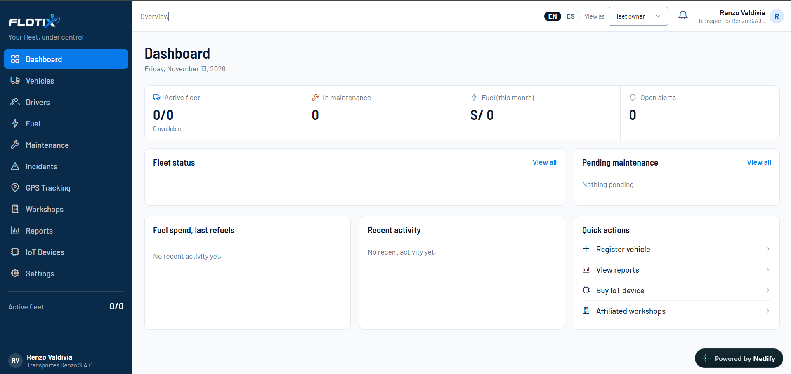
> *Web Application: dashboard*

> 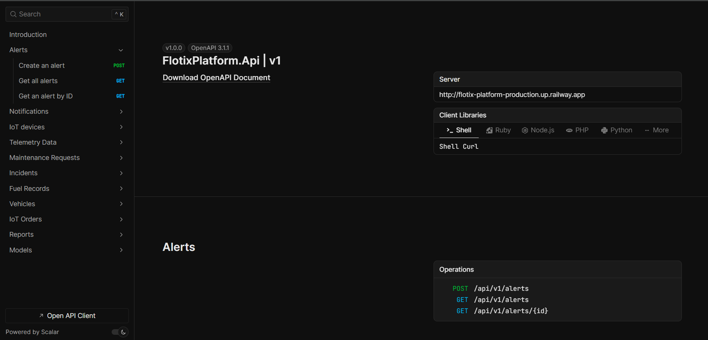
> *Web Application: En Scalar*

#### 5.2.3.6. Services Documentation Evidence for Sprint Review

En este Sprint se documentaron con OpenAPI, mediante Scalar, los endpoints del API Application incluidos en el alcance. La documentación, redactada en inglés como idioma por defecto, agrupa los endpoints por bounded context e incluye parámetros, cuerpos de request, códigos de respuesta y ejemplos con datos de muestra.

**Repositorio de Web Services:** https://github.com/upc-pre-202620-1asi0730-8150-DevsTeam/flotix-platform

**Documentación Scalar desplegada:** https://flotix-platform-production.up.railway.app/scalar

Todas las rutas parten de `{baseUrl}/api/v1`.

| Endpoint | Verbo | Sintaxis de llamada | Parámetros | Response |
|---|:---:|---|---|---|
| `/vehicles` (TS01) | POST | `POST /api/v1/vehicles` | Body: `plate`, `type`, `mileage`, `status`, `driverId` (opcional) | 201 con el vehículo creado. 400 con el detalle del error si los datos están incompletos |
| `/vehicles` (TS01) | GET | `GET /api/v1/vehicles` | Ninguno | 200 con la lista de vehículos, su estado y kilometraje |
| `/vehicles/{id}` (TS05) | PUT | `PUT /api/v1/vehicles/{id}` | Path: `id`. Body: `plate`, `type`, `mileage`, `status`, `driverId` | 200 con el vehículo actualizado. 400 si los datos son inválidos. 404 si no existe |
| `/vehicles/{id}` (TS05) | DELETE | `DELETE /api/v1/vehicles/{id}` | Path: `id` | 204 sin contenido. 404 si no existe |
| `/vehicles/{id}/driver` (TS06) | PUT | `PUT /api/v1/vehicles/{id}/driver` | Path: `id`. Body: `driverId` | 200 con la asignación y el conductor en estado "En ruta". 404 si el vehículo o el conductor no existen |
| `/vehicles/{id}/driver` (TS06) | DELETE | `DELETE /api/v1/vehicles/{id}/driver` | Path: `id` | 200 con el vehículo en conductor "Sin asignar" |
| `/fuel-records` (TS08) | POST | `POST /api/v1/fuel-records` | Body: `vehicleId`, `liters`, `totalCost`, `odometer`, `date` | 201 con la recarga creada. 400 si los datos son inválidos o el kilometraje es menor al de la última recarga. 404 si el vehículo no existe |
| `/vehicles/{vehicleId}/fuel-records` (TS09, TS10) | GET | `GET /api/v1/vehicles/{vehicleId}/fuel-records` | Path: `vehicleId` | 200 con las recargas de la más reciente a la más antigua, con `efficiencyKmPerLiter` (nulo en la primera recarga) e `isAnomalous` |
| `/maintenance-requests` (TS12) | POST | `POST /api/v1/maintenance-requests` | Body: `vehicleId`, `description`, `workshopId` (opcional) | 201 con la solicitud en estado "Pendiente". 404 si el vehículo o el taller no existen |
| `/maintenance-requests` (TS12) | GET | `GET /api/v1/maintenance-requests` | Ninguno | 200 con las solicitudes, su estado y presupuesto, junto con las abiertas, en reparación y completadas |
| `/maintenance-requests/{id}/diagnosis` (TS03) | PUT | `PUT /api/v1/maintenance-requests/{id}/diagnosis` | Path: `id`. Body: `diagnosis`, `estimatedCost` | 200 con la solicitud en estado "Presupuestado". 409 si la solicitud no está en "Pendiente" |
| `/maintenance-requests/{id}/approval` (TS03) | PATCH | `PATCH /api/v1/maintenance-requests/{id}/approval` | Path: `id`. Body: `decision` (`approved` o `rejected`) | 200 con la solicitud en "Aprobado" o "Rechazado". 409 si no está en "Presupuestado" |
| `/maintenance-requests/{id}/start` (TS03, TS13) | PATCH | `PATCH /api/v1/maintenance-requests/{id}/start` | Path: `id` | 200 con la solicitud en "En reparación" y el vehículo en "En mantenimiento". 409 si no está en "Aprobado" |
| `/maintenance-requests/{id}/completion` (TS03, TS13) | PATCH | `PATCH /api/v1/maintenance-requests/{id}/completion` | Path: `id` | 200 con la solicitud en "Completado" y el vehículo en "Disponible". 409 si la solicitud ya está cerrada o no está en reparación |
| `/maintenance-requests/{id}` (TS15) | DELETE | `DELETE /api/v1/maintenance-requests/{id}` | Path: `id` | 204 sin contenido. 404 si no existe |
| `/workshops` (TS14) | GET | `GET /api/v1/workshops?search={text}` | Query: `search` (opcional, nombre o ciudad) | 200 con los talleres que coinciden y su cantidad. Sin coincidencias, 200 con una lista vacía |
| `/incidents` (TS16) | POST | `POST /api/v1/incidents` | Body: `vehicleId`, `description` | 201 con la incidencia en estado "Abierto" y notificación para el Dueño. 400 si faltan datos. 404 si el vehículo no existe |
| `/incidents/{id}/review` (TS17) | PATCH | `PATCH /api/v1/incidents/{id}/review` | Path: `id` | 200 con la incidencia en "En revisión" |
| `/incidents/{id}/resolution` (TS17) | PATCH | `PATCH /api/v1/incidents/{id}/resolution` | Path: `id` | 200 con la incidencia en "Resuelto". 409 si no está en "En revisión" |
| `/incidents` (TS18) | GET | `GET /api/v1/incidents` | Ninguno | 200 con las incidencias y los totales por estado |
| `/incidents/{id}` (TS18) | DELETE | `DELETE /api/v1/incidents/{id}` | Path: `id` | 204 sin contenido. 404 si no existe |
| `/telemetry` (TS02) | POST | `POST /api/v1/telemetry` | Body: `deviceId`, `latitude`, `longitude`, `speed`, `timestamp` | 202 si el paquete es válido y se procesa. 400 si no cumple el esquema (se descarta y se registra en el log de errores) |
| `/telemetry/latest` (TS02) | GET | `GET /api/v1/telemetry/latest` | Ninguno | 200 con la última posición y velocidad de cada vehículo con dispositivo |
| `/reports/fuel` (TS04) | GET | `GET /api/v1/reports/fuel?from={date}&to={date}` | Query: `from`, `to` (YYYY-MM-DD) | 200 con el reporte de combustible. Si no hay registros, 200 con un mensaje informativo |
| `/reports/maintenance` (TS04) | GET | `GET /api/v1/reports/maintenance?from={date}&to={date}` | Query: `from`, `to` (YYYY-MM-DD) | 200 con el reporte de mantenimiento. Si no hay registros, 200 con un mensaje informativo |
| `/dashboard` (TS28) | GET | `GET /api/v1/dashboard` | Ninguno | 200 con vehículos disponibles y en mantenimiento, gasto de combustible, alertas abiertas, incidencias urgentes y mantenimientos pendientes |

**Capturas de la interacción con la documentación**

> 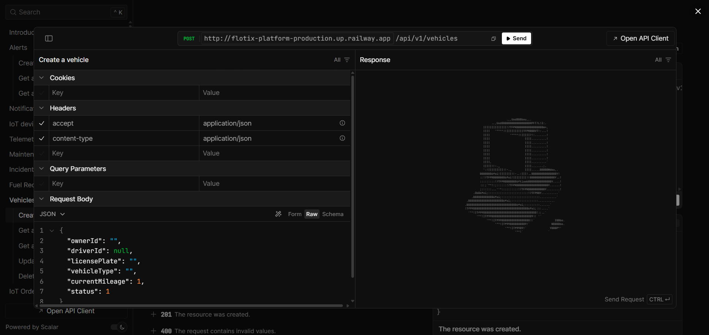
> *Scalar: ejecución de `POST /vehicles` con datos de muestra*

> 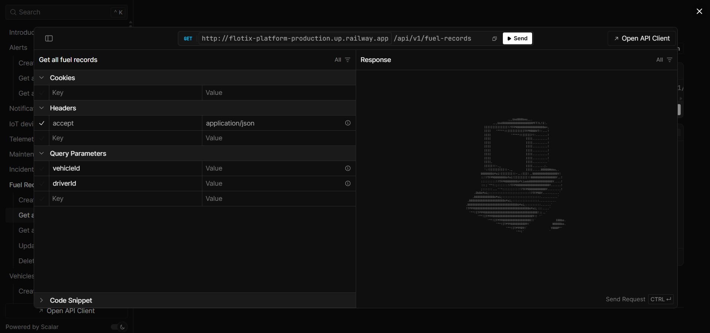
> *Scalar: respuesta de `GET /vehicles/{vehicleId}/fuel-records`*

#### 5.2.3.7. Software Deployment Evidence for Sprint Review

En este Sprint se desplegó por primera vez el API Application junto con su base de datos PostgreSQL, y se actualizó el despliegue de la Web Application para que consuma el API.

**Infraestructura utilizada**

- Repositorio del backend: GitHub (`flotix-Platform`).
- Plataforma de hosting del backend: Railway.
- Base de datos PostgreSQL: Neon Console.
- Web Application: Netlify.

1. **Creación de cuentas y recursos:** se creó la cuenta en el proveedor de nube y se aprovisionó el servicio del API y la instancia de PostgreSQL.
2. **Configuración del proyecto:** se definieron las variables de entorno (cadena de conexión y orígenes permitidos por CORS) y el comando de build del proyecto .NET. 
3. **Migraciones y datos semilla:** se aplicaron las migraciones de Entity Framework Core y se cargaron los datos semilla sobre la base de datos desplegada.
4. **Publicación automática:** cada push a la rama `main` dispara el build y la publicación del servicio.
5. **Web Application:** se configuró la URL del API en el build de producción y se volvió a publicar en Netlify.
6. **Verificación:** se comprobó el acceso a la documentación en Scalar y la respuesta de los endpoints desde el entorno desplegado.
> 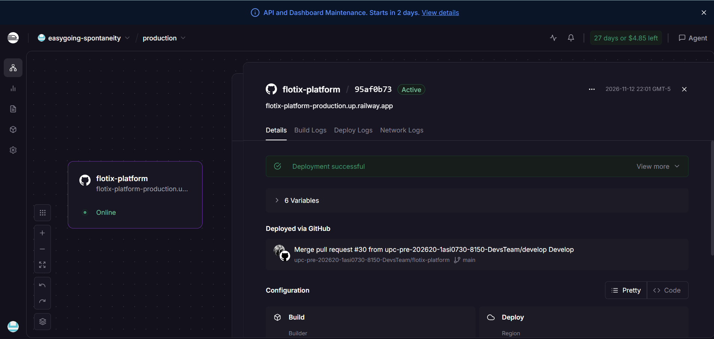
> *Servicio del backend desplegado*

> 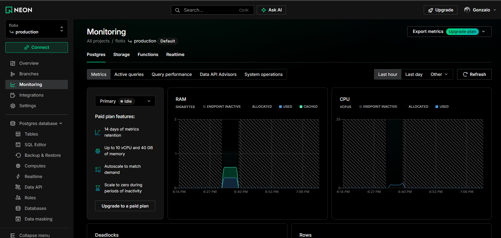
> *Base de datos PostgreSQL aprovisionada*

**URL del Backend:** https://flotix-platform-production.up.railway.app

**URL de Scalar:** https://flotix-platform-production.up.railway.app/scalar

**URL de la Web Application:** https://flotix-app-web.netlify.app

#### 5.2.3.8. Team Collaboration Insights during Sprint

Durante el Sprint 3, el equipo Developers Team distribuyó el trabajo por bounded context. Gonzalo Jaime Forcelledo lideró la plataforma (estructura del API, base de datos, despliegue y cliente HTTP compartido), Vehicle & Fleet Management y el dashboard; Mauricio Ramirez Rodriguez lideró Fuel Control y la creación y consulta de solicitudes de mantenimiento; Gustavo Olivares Lao lideró Real-Time Monitoring, Reporting & Analytics y las transiciones de estado del mantenimiento; y Joaquin Lechuga Aguilar lideró Incident Management y la sincronización del mantenimiento con el estado del vehículo, los talleres y la eliminación de solicitudes.

Siguiendo la retrospectiva del Sprint 2, el contrato de repositorio definido para el frontend se mantuvo como guía de los endpoints, lo que permitió reemplazar la capa local por el cliente HTTP módulo por módulo sin tocar las capas de aplicación ni de presentación. El trabajo se organizó con GitFlow, una rama `feature/<nombre>` por funcionalidad y Pull Requests revisados por al menos un integrante antes de cada merge a `develop`. Todos los integrantes participaron en los Web Services y en la Web Application.

| Team Member | Web Application | Web Services |
|---|---|---|
| Jaime Forcelledo, Gonzalo Alexander | Cliente HTTP compartido, Fleet y dashboard | Plataforma, OpenAPI, despliegue, vehículos y panel general |
| Ramirez Rodriguez, Mauricio | Fuel Control y solicitudes de mantenimiento | Combustible y creación y consulta de solicitudes |
| Olivares Lao, Gustavo | Tracking, Analytics y acciones de la Mecánica | Telemetría IoT, reportes y transiciones del mantenimiento |
| Lechuga Aguilar, Joaquin | Incidents, talleres y eliminación de solicitudes | Incidencias, sincronización del vehículo y talleres |

> 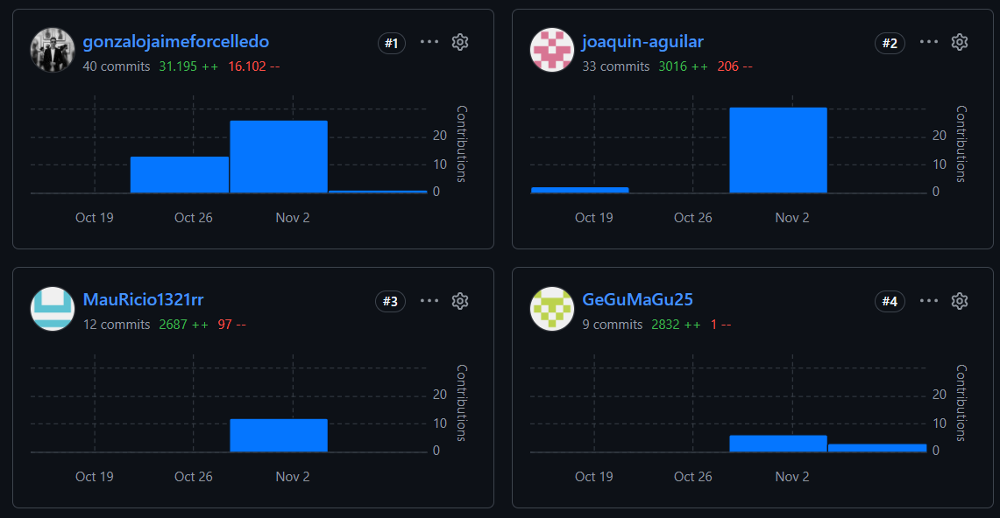
> *GitHub Insights: contribuciones en `flotix-platform`*

> 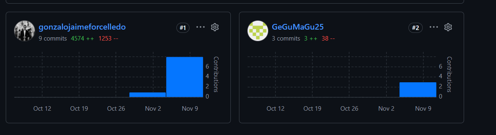
> *GitHub Insights: contribuciones en `flotix-webapp`*

