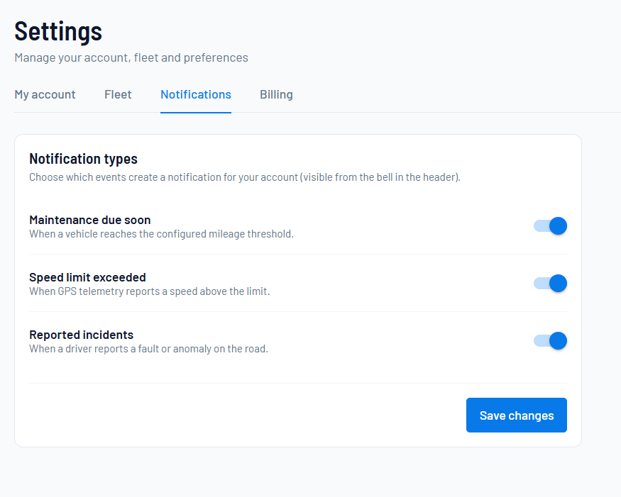
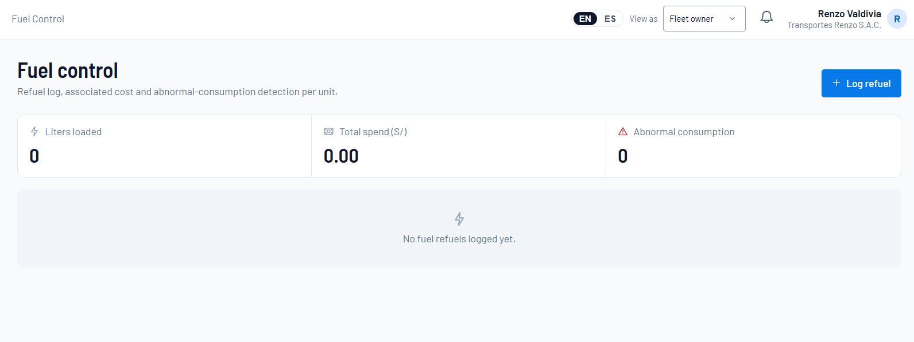
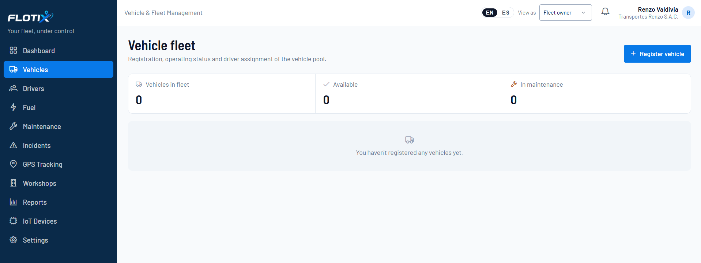
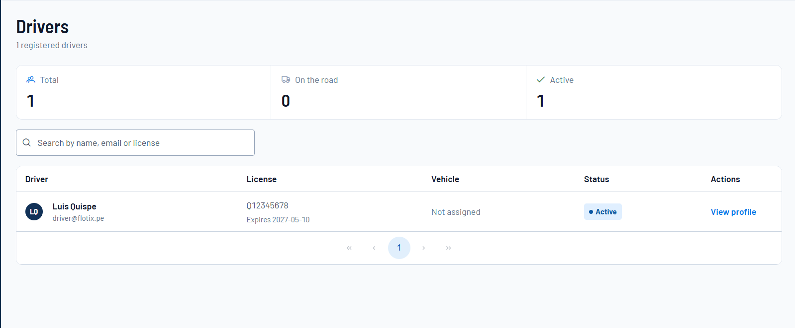
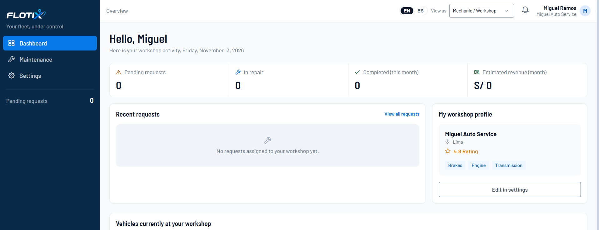
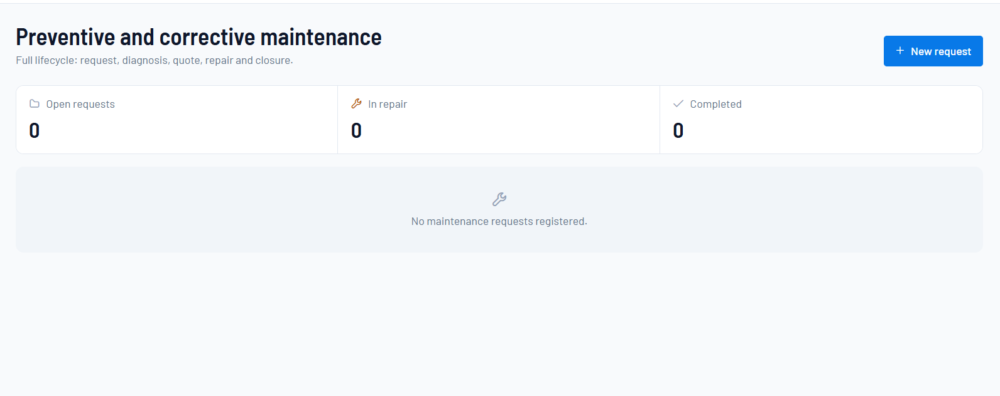

## 5.3. Validation Interviews

> Los campos marcados como corresponden a datos de las sesiones reales (entrevistados, tiempos en el video, resúmenes y hallazgos). No se redactaron hallazgos ni resúmenes de entrevistas que aún no se realizaron. Los bullets de "Características del arquetipo" se tomaron de las User Personas del capítulo 2.3 y deben ajustarse a cada entrevistado.

### 5.3.1. Diseño de Entrevistas

Se diseñaron entrevistas semiestructuradas con el objetivo de validar la propuesta de solución y evaluar la experiencia de los usuarios al interactuar con el Landing Page y la Web Application de Flotix. Las preguntas fueron elaboradas considerando las necesidades y responsabilidades de cada segmento identificado: dueños de vehículos, conductores y mecánicas. En cada sesión, el entrevistado ejecutó tareas del producto mientras expresaba en voz alta lo que pensaba, y la sesión se grabó en video con su autorización.

#### Preguntas para el Segmento: Dueño de Vehículos

1. Al ingresar a la página, ¿qué entiendes que hace este producto?
2. ¿El contenido te parece relevante para la gestión de tus vehículos? ¿Por qué?
3. ¿Fue fácil encontrar dónde registrar un vehículo y asignarle un conductor?
4. ¿Los estados de la flota y de las solicitudes de mantenimiento (Disponible, En mantenimiento, Pendiente, Presupuestado, Aprobado, Completado) son claros para ti?
5. ¿Pudiste identificar un consumo de combustible anómalo o una alerta de velocidad? ¿Cómo te pareció que se presenta esa información?
6. ¿Qué tan claro fue el proceso para enviar una solicitud a un taller y aprobar el presupuesto?
7. ¿Usarías este sistema para gestionar tu flota? ¿Qué cambiarías primero de la plataforma?

#### Preguntas para el Segmento: Conductor

1. Al ingresar a la página, ¿qué entiendes que hace este producto?
2. ¿El contenido te parece relevante para tu trabajo diario? ¿Por qué?
3. ¿Fue fácil registrar una recarga de combustible desde el celular?
4. ¿Entendiste qué información se te solicita en el formulario (litros, costo y kilometraje)?
5. ¿La sección de incidencias te parece fácil de usar durante tu jornada?
6. ¿Qué tan fácil o difícil fue navegar entre las secciones desde el smartphone?
7. ¿Usarías esta herramienta en lugar de WhatsApp o llamadas para reportar fallas? ¿Por qué?

#### Preguntas para el Segmento: Mecánica

1. Al ingresar a la página, ¿qué entiendes que hace este producto?
2. ¿El contenido te parece relevante para tu taller? ¿Por qué?
3. ¿Fue fácil ubicar la solicitud asignada a tu taller y revisar los datos del vehículo?
4. ¿Entendiste qué información se te solicita para registrar el diagnóstico y la cotización?
5. ¿Los estados de la solicitud (Pendiente, Presupuestado, Aprobado, En reparación, Completado) son claros para ti?
6. Al iniciar y completar una reparación, ¿fue claro qué ocurre con el estado del vehículo?
7. ¿Crees que esta herramienta te ayudaría a organizar mejor tus atenciones? ¿Por qué sí o no?

#### Objetivo de las Entrevistas

Las entrevistas tuvieron como finalidad validar la comprensión de la propuesta de valor, la facilidad de uso del Landing Page y de la Web Application, la claridad de la información presentada y la utilidad percibida por cada segmento de usuario. Asimismo, permitieron identificar oportunidades de mejora relacionadas con la navegación, la gestión de la flota, del combustible y del mantenimiento, y la interacción general con la plataforma.

### 5.3.2. Registro de Entrevistas

**Link del video consolidado de entrevistas:https://acortar.link/Y2NB9J**

### Entrevista 1

| Campo | Información                    |
|---------|--------------------------------|
| Segmento | Dueño                          |
| Inicio | 0:00                           |
| Duración | 10 min 35 s                    |
| Nombre completo | Mabel |
| Distrito | Comas                          |
#### Características del arquetipo

- Dueño de uno o varios vehículos de transporte particular, de pasajeros o de carga.
- Coordina con conductores y talleres mediante WhatsApp, llamadas y hojas de cálculo.
- Busca controlar el gasto de combustible y conocer el estado real de cada unidad.
- Le preocupan los mantenimientos correctivos inesperados.
- Valora contar con información centralizada para tomar decisiones.

#### Resumen de la entrevista

Mabel, dueña de una pequeña empresa de reparto en Lima con seis camionetas y cinco choferes, participó en una demostración guiada con pantalla compartida y un cuestionario estructurado. Actualmente controla unidades, combustible y mantenimientos con Excel, llamadas y WhatsApp, por donde recibe fotos de vouchers y cotizaciones de talleres, por lo que pierde visibilidad de qué conductor maneja cada camioneta. Comprendió de inmediato la propuesta de valor de Flotix y la consideró muy relevante, aunque habría querido ver más rápido si funciona desde el celular, pues pasa casi todo el día en la calle. Registró un vehículo con rapidez gracias a la visibilidad del botón, pero no habría encontrado a tiempo cómo asignar un conductor, ya que intuitivamente lo buscaría en la sección de conductores. Entendió sin dificultad los estados de flota y mantenimiento y sus colores, y sugirió renombrar "presupuestado" a "presupuesto por aprobar". Identificó al instante el consumo anómalo de combustible de la camioneta MTX 556 y la alerta de exceso de velocidad en la Panamericana, y pidió recibir esas alertas como notificaciones en el teléfono. Juzgó el flujo de solicitud al taller y aprobación de cotización (por ejemplo, 2,500 soles por pastillas de freno) más ordenado que WhatsApp, y propuso desglosar repuestos y mano de obra y agregar una confirmación antes de aprobar para evitar clics accidentales. Afirmó que reemplazaría Excel por la plataforma y le dio 8 sobre 10, que subiría a 9 o 10 con notificaciones móviles.

---

### Entrevista 2

| Campo | Información                     |
|---------|---------------------------------|
| Segmento | Conductor                       |
| Inicio | 10:36                           |
| Duración | 5 min 14 s                      |
| Nombre completo | Ronald |
| Distrito | San Juan del Lurigancho         |
#### Características del arquetipo

- Opera diariamente un vehículo de la flota.
- Se comunica con el dueño mediante WhatsApp y llamadas.
- Registra combustible, kilometraje e incidencias de forma manual.
- Necesita herramientas rápidas y sencillas desde el smartphone.
- Valora poder reportar fallas sin intercambios largos de mensajes.

#### Resumen de la entrevista

Ronald, conductor operativo acostumbrado a registrar sus datos en papel o a enviar reportes sueltos por mensajería, participó en un recorrido guiado por las cuatro secciones principales de Flotix (Dashboard, Combustible, Incidencias y Configuración), seguido de un cuestionario estructurado de siete preguntas. Comprendió con claridad la propuesta de valor desde el primer contacto: una herramienta centralizada para conocer la unidad asignada en su turno, verificar kilometraje y próximos mantenimientos, registrar abastecimientos y reportar fallas en ruta. Calificó la navegación desde el celular como intuitiva y ágil, y valoró el botón azul de acceso directo para registrar combustible, cuyos campos (litros, costo en soles y kilometraje) le resultaron familiares porque coinciden con el ticket del grifo y el odómetro. Consideró práctico y rápido el módulo de incidencias, en especial poder ver en tiempo real si un reporte sigue abierto o ya fue solucionado. No reportó dificultades ni sugirió cambios, y afirmó que reemplazaría WhatsApp y las llamadas por la plataforma porque deja la información ordenada y accesible para el conductor y el personal administrativo.

---

### Entrevista 3

| Campo | Información     |
|---------|-----------------|
| Segmento | Mecánica        |
| Inicio | 15:51           |
| Duración | 10 min 40 s     |
| Nombre completo | Jorge           |
| Distrito | La victoria     |

#### Características del arquetipo

- Mecánico o taller que atiende vehículos particulares y de empresas.
- Recibe solicitudes mediante llamadas y WhatsApp, y se organiza con Word y calendarios.
- Necesita consultar el historial del vehículo antes de recibirlo.
- Enfrenta saturación cuando hay alta demanda y pocos mecánicos.
- Prefiere que el diagnóstico lo realice el equipo de mecánicos.

#### Resumen de la entrevista

Jorge, mecánico con poca afinidad tecnológica que gestiona su trabajo en hojas de cálculo de Excel, participó en una prueba de usabilidad moderada con pantalla compartida y una entrevista semiestructurada. Sin ayuda creó una nueva orden de mantenimiento (New Request), registró una cotización de seiscientos soles y avanzó los estados del servicio tras simular la aceptación del presupuesto por el cliente. Confirmó que la interfaz se entiende a primera vista y que la secuencia de estados (revisión inicial, aprobación de cotización, ejecución de la reparación y entrega final) refleja el flujo real de su taller. Identificó el indicador de solicitudes pendientes del dashboard como el dato más útil, porque le permite conocer su carga de trabajo antes de aceptar nuevas órdenes, y validó que el alta de vehículos sea responsabilidad de los dueños de la flota. Propuso tres mejoras: registrar y visualizar boletas por servicio; ampliar los campos técnicos de la solicitud (placa, marca, tipo de vehículo y tipo de motor); y añadir un buscador y un listado de toda la flota, no solo de las unidades averiadas, con antigüedad, historial de atenciones y kilometraje por intervención, para anticipar mantenimientos preventivos y revisiones técnicas.

### 5.3.3. Evaluaciones según heurísticas

#### UX Heuristics & Principles Evaluation

**Usability – Inclusive Design – Information Architecture**

| Campo | Detalle                                              |
|---|------------------------------------------------------|
| **CARRERA** | Ingeniería de Software                               |
| **CURSO** | Aplicaciones Web                                     |
| **SECCIÓN** | 8150                                                 |
| **PROFESORES** | Todos                                                |
| **AUDITOR** | Developer Team                                       |
| **CLIENTE(S)** | Mabel (Dueño), Ronald (Conductor) y Jorge (Mecánica) |

**SITE o APP A EVALUAR:**
**FLOTIX** (Landing Page y Web Application de la plataforma de gestión de flotas con IoT).

#### TAREAS A EVALUAR

El alcance de esta evaluación incluye la revisión de la usabilidad de las siguientes tareas:

- Comprensión de la propuesta de valor, beneficios y planes en el Landing Page.
- Registro de vehículos y asignación de conductores.
- Consulta del historial de combustible e identificación de consumos anómalos.
- Registro de recargas de combustible desde el smartphone (Conductor).
- Envío de solicitudes de mantenimiento a un taller y aprobación del presupuesto.
- Registro de diagnóstico y cotización, inicio y cierre de la reparación (Mecánica).
- Reporte de incidencias (Conductor).
- Monitoreo de la flota y revisión de alertas de velocidad.
- Compra de dispositivos IoT.
- Consulta del panel general y exportación de reportes.

#### TAREAS NO INCLUIDAS

- Comparación de rendimiento por vehículo.
- Consulta del historial de reportes exportados.
- Consulta de términos y condiciones.

---

#### ESCALA DE SEVERIDAD

| Nivel | Descripción |
|:-:|---------|
| 1 | Problema superficial: puede ser fácilmente superado por el usuario o se presenta con muy poca frecuencia. No necesita ser arreglado a menos que exista disponibilidad de tiempo. |
| 2 | Problema menor: puede ocurrir más frecuentemente o es un poco más difícil de superar. Se le debe asignar una prioridad baja de cara al siguiente release. |
| 3 | Problema mayor: ocurre frecuentemente o los usuarios no son capaces de resolverlo. Es importante que sea corregido y se le debe asignar una prioridad alta. |
| 4 | Problema muy grave: error de gran impacto que impide al usuario continuar con el uso de la herramienta. Es imperativo que sea corregido antes del lanzamiento. |

---

#### TABLA RESUMEN

| # | Problema | Severidad | Heurística / Principio Violado |
|---|-----------|:-:|-------------------------------|
| 1 | Las alertas de consumo anómalo y exceso de velocidad solo se ven dentro de la plataforma, sin notificaciones al teléfono | 3 | Inclusive Design: considera la situación del usuario |
| 2 | La aprobación de una cotización no pide confirmación | 3 | Usability: prevención de errores |
| 3 | La asignación de conductor está dentro de la edición del vehículo y no en la sección de conductores | 2 | Information Architecture: is it findable |
| 4 | El estado "Presupuestado" no deja claro que requiere la aprobación del Dueño | 2 | Usability: correspondencia entre el sistema y el mundo real |
| 5 | La Mecánica no cuenta con un buscador ni un listado de toda la flota con su historial | 3 | Usability: flexibilidad y eficiencia de uso |
| 6 | La solicitud de mantenimiento no incluye los datos técnicos del vehículo (placa, marca, tipo y motor) | 2 | Information Architecture: is it useful |

---

#### DESCRIPCIÓN DE PROBLEMAS

##### Problema #1: Alertas sin notificaciones al teléfono

**Severidad:** 3
**Heurística violada:** Inclusive Design: considera la situación del usuario

**Fuente:** Mabel (Dueño)

###### Problema

Durante el monitoreo de la flota, Mabel identificó de inmediato el consumo anómalo de combustible resaltado en rojo en la camioneta MTX 556 y la alerta de exceso de velocidad en la Panamericana. Sin embargo, indicó que necesita recibir esas alertas como notificaciones en su teléfono, porque pasa casi todo el día en la calle y no está frente a la plataforma cuando ocurren. Condicionó su puntuación de recomendación a este punto: calificó la plataforma con 8 sobre 10 y dijo que subiría a 9 o 10 si se incorporan las notificaciones móviles. Además, comentó que le habría gustado comprobar más rápido si la herramienta funciona desde el celular.

###### Recomendación

Incorporar notificaciones push o por correo para las alertas de consumo anómalo y exceso de velocidad, y comunicar de forma visible en el Landing Page y en la pantalla inicial que la plataforma se puede usar desde el celular.

---

##### Problema #2: Aprobación de cotización sin confirmación

**Severidad:** 3
**Heurística violada:** Usability: prevención de errores

**Fuente:** Mabel (Dueño)

###### Problema

Al revisar el flujo de envío de una solicitud al taller y aprobación de la cotización (ejemplo de cambio de pastillas de freno por 2,500 soles), Mabel lo consideró más ordenado que WhatsApp. No obstante, observó que la aprobación se ejecuta directamente y propuso un aviso de confirmación para evitar clics accidentales. Como la aprobación compromete un gasto y activa el inicio de la reparación, un clic erróneo tiene un costo alto.

###### Recomendación

Agregar un diálogo de confirmación antes de aprobar o rechazar una cotización, que muestre el monto y el vehículo involucrado.

---

##### Problema #3: Asignación de conductor difícil de encontrar

**Severidad:** 2
**Heurística violada:** Information Architecture: is it findable

**Fuente:** Mabel (Dueño)

###### Problema

Mabel registró un vehículo nuevo con rapidez gracias a la visibilidad del botón. Sin embargo, señaló que no habría encontrado tan rápido la opción para asignar un conductor, porque está dentro de la edición del vehículo y ella la buscaría de forma intuitiva en la sección de conductores. Esto contradice el modelo mental del Dueño, cuya prioridad es saber qué conductor maneja cada unidad.

###### Recomendación

Permitir asignar o cambiar el vehículo también desde la sección de conductores, y mostrar el conductor asignado de forma visible en el listado de vehículos.

---

##### Problema #4: Estado "Presupuestado" ambiguo

**Severidad:** 2
**Heurística violada:** Usability: correspondencia entre el sistema y el mundo real

**Fuente:** Mabel (Dueño)

###### Problema

Mabel entendió sin dificultad los estados de flota y mantenimiento (disponible, en mantenimiento, pendiente, aprobado y completado) junto con sus colores. Pero propuso renombrar "Presupuestado" como "Presupuesto por aprobar", porque el término actual no le deja claro que es el estado en el que debe dar su autorización. Describe lo que hizo el taller, no la acción que se espera del Dueño.

###### Recomendación

Renombrar el estado a "Presupuesto por aprobar" en la vista del Dueño, o agregar un indicador de acción pendiente que lo destaque.

---

##### Problema #5: Falta de buscador y listado completo de la flota para la Mecánica

**Severidad:** 3
**Heurística violada:** Usability: flexibilidad y eficiencia de uso

**Fuente:** Jorge (Mecánica)

###### Problema

Jorge creó de forma autónoma una orden de mantenimiento, registró una cotización de seiscientos soles y avanzó los estados del servicio. Sin embargo, indicó que la plataforma solo le muestra las unidades averiadas y necesita un buscador y un listado general de toda la flota. Ese listado debería mostrar la antigüedad de cada vehículo, su historial de atenciones y el kilometraje de cada intervención, para anticipar mantenimientos preventivos y revisiones técnicas. Este problema afecta la tarea principal de la Mecánica y obliga a recurrir a medios externos como Excel.

###### Recomendación

Agregar a la vista de la Mecánica un listado de los vehículos afiliados con buscador por placa, y una ficha por vehículo con antigüedad, historial de atenciones y kilometraje por intervención.

---

##### Problema #6: Solicitud de mantenimiento sin datos técnicos del vehículo

**Severidad:** 2
**Heurística violada:** Information Architecture: is it useful

**Fuente:** Jorge (Mecánica)

###### Problema

Jorge consideró que la solicitud de mantenimiento no incluye la información técnica que necesita para atender el vehículo. Pidió ampliar los campos con placa, marca, tipo de vehículo (sedán, camioneta o pickup) y tipo de motor. También propuso registrar y visualizar las boletas de cada servicio, algo que hoy no existe en la plataforma.

###### Recomendación

Mostrar en cada solicitud los datos técnicos del vehículo, tomados del registro de la flota, y evaluar un campo para adjuntar y consultar la boleta de cada servicio.

