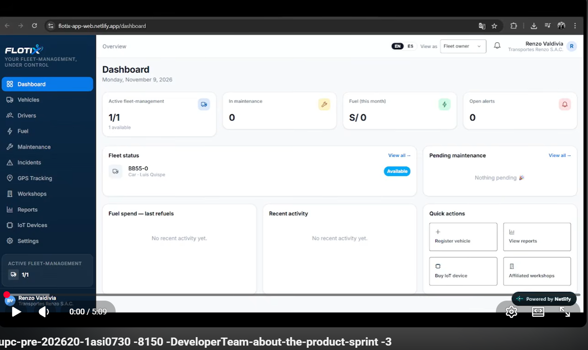

## 5.4. Video About-the-Product

El video *About-the-Product* presenta **Flotix** a través de un recorrido funcional sobre la aplicación web desplegada en Netlify con cambio de idioma (`EN`/`ES`) para los tres segmentos objetivo (Dueño, Conductor y Mecánica). Muestra los flujos principales de la plataforma: panel de flota, gestión de vehículos y conductores, registro de combustible, incidencias en ruta, monitoreo GPS, tienda de dispositivos IoT y el ciclo completo de mantenimiento con talleres afiliados.

- **URL del video:** https://youtu.be/clagWq_iPAw
- **Duración (timing):** `00:05:09`

> **Figura 67.** Cuadro representativo del video About-the-Product.
>
> 
